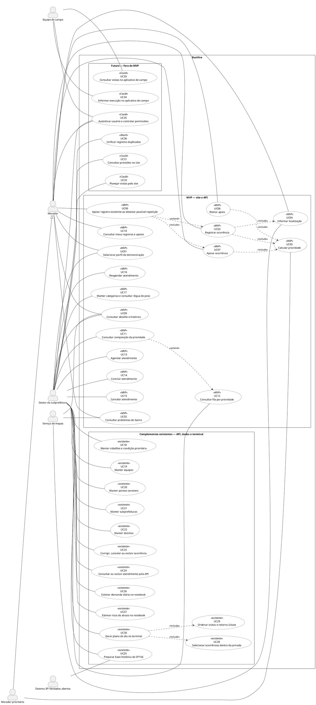

# RuaViva — Agile Methodology With Squad Framework

**FIAP · Global Solution 2026.2 · Equipe RuaViva**  
**Anthony Gonçalves Sforzin — RM 562096**  
**Cesar Aaron Herrera — RM 565398**  
**Território:** Liberdade, Rua Barão de Iguape, Subprefeitura Sé, São Paulo.

O [catálogo de casos de uso](casos-de-uso.json) e o [backlog](backlog.csv) ligam as histórias às telas, à API e aos programas de análise.

## 1. Apresentação descritiva da ideia — 10 pontos

### Problema e recorte

Um bueiro entupido, uma calçada quebrada ou um buraco no asfalto muda o caminho de quem anda pela Rua Barão de Iguape. Para uma pessoa idosa com baixa visão, desviar pode significar pisar na rua sem conseguir avaliar o risco. Para quem trabalha no comércio, significa interromper o atendimento para registrar uma reclamação. Depois do registro, ambos precisam saber se alguém já avisou, se existe visita marcada e se o serviço foi concluído.

O RuaViva concentra esses registros em um mapa e uma lista do bairro, permite apoiar a ocorrência de um vizinho e organiza a fila da subprefeitura por critérios explícitos. O foco inicial é a Liberdade, com atenção à Rua Barão de Iguape, sob responsabilidade territorial da Subprefeitura Sé. Escolher esse recorte permite relacionar os registros a endereços concretos e comparar a jornada do morador com o trabalho do gestor.

### Escutar: relato de quem convive com o problema

Cesar Aaron Herrera, integrante da equipe, mora na região e respondeu, em 16/11/2026, às perguntas que guiam a etapa "Escutar" do enunciado. Resumo do que ele contou:

- **Problemas que mais vê perto de casa:** buraco no asfalto, lixo acumulado na calçada e iluminação pública apagada.
- **Se já pediu conserto:** nunca pediu. Não conhecia o 156.
- **Se soube do resultado:** não sabe se algo foi resolvido.
- **Problema que continua:** os buracos na rua seguem sem conserto.
- **Quem sofre mais:** quem empurra carrinho de bebê, que precisa desviar do lixo deixado na calçada.

| O que ouvimos | Decisão no RuaViva |
|---|---|
| Não conhecia o canal oficial e nunca registrou. | Registro em três passos, linguagem simples e entrada sem burocracia; o detalhe mostra o caminho da Ouvidoria do SP156 quando o prazo vence. |
| Não sabe se o problema foi resolvido. | Linha do atendimento com a situação e as datas que o sistema tem, e o número do registro para acompanhar. |
| Os buracos continuam, mesmo sendo conhecidos. | O mapa mostra o que os vizinhos já registraram e o apoio ("Isso também me afeta") soma na prioridade, em vez de virar um pedido repetido. |
| Carrinho de bebê desvia do lixo na calçada. | Categorias de calçada, entulho e lixeira; ponto sensível perto do local aumenta a prioridade. |

Iluminação pública apagada não está entre as categorias do MVP e fica registrada como evolução.

### O que sustenta as escolhas

| Evidência do projeto | Consequência para o RuaViva |
|---|---|
| Em 2025, selecionamos **507.859 pedidos de zeladoria nas 32 subprefeituras**. | Usamos o SP156 para conhecer os serviços mais pedidos em São Paulo. |
| No teste de **outubro a dezembro de 2025**, **87% dos 526 pedidos de “Calçadas, guias e postes” da Sé** passaram de sete dias. | Destacamos o prazo e a situação no detalhe do registro. A taxa abrange toda a Subprefeitura Sé. |
| Segunda-feira concentra mais pedidos na análise de demanda. | No notebook, levamos o dia da semana em conta ao estimar a demanda. |
| A base demonstrativa do banco tem **15 ocorrências**, das quais **9 na Barão de Iguape**, com endereço, coordenadas, tipo e datas provenientes do SP156 do terceiro trimestre de 2026. | Há exemplos territoriais para demonstrar o fluxo. Esse retrato de 2026 é diferente da base estatística de 2025. Cidadãos, apoios, equipes, descrições e atendimentos são simulados. |

Fontes locais: [Data Science — README](../data-science/README.md), [notebook executado, análises da Sé e recomendações](../data-science/zeladoria_sp156.ipynb) e [Database — dados de exemplo](../database/README.md). Fonte pública original indicada nesses arquivos: [Dados do SP156, Prefeitura de São Paulo](https://dados.prefeitura.sp.gov.br/dataset/dados-do-sp156), licença CC0, sem dados pessoais dos solicitantes.

### Público-alvo e solução

O público principal são moradores que dependem de ruas e calçadas utilizáveis, especialmente idosos, pessoas com deficiência e responsáveis por carrinhos de bebê. Comerciantes também podem registrar e apoiar como moradores. O gestor precisa comparar pendências, entender a prioridade e organizar visitas. A equipe de campo é beneficiária secundária: hoje o gestor registra os atendimentos por ela; uma interface própria está no backlog futuro.

O morador escolhe um perfil de demonstração, consulta problemas da Liberdade e registra categoria, localização e detalhes em três passos. Se aparecer um problema pendente da mesma categoria a até **60 metros**, pode apoiar o registro existente. O sistema sugere uma possível repetição; a pessoa decide se é o mesmo problema. Não há união automática de ocorrências.

O gestor recebe a fila de ocorrências **ABERTA e sem atendimento válido**, da maior para a menor prioridade. Visitas canceladas não retiram o caso dessa fila. Agendar muda o estado para **EM_ANDAMENTO**; concluir uma visita muda para **RESOLVIDA** e cancela outras visitas agendadas do mesmo caso. Cancelar o último agendamento devolve a ocorrência pendente para **ABERTA**. Cancelar uma ocorrência é uma operação distinta, disponível na API, e também cancela suas visitas agendadas.

A prioridade é calculada pela regra implementada em Java e reproduzida no banco:

> **Prioridade = peso da categoria × 10 + 2 por apoio + 15 se houver ponto sensível a até 200 m + 10 se o autor for prioritário (idoso/PcD).**

O peso varia de **1 a 5** e é definido pelo gestor. A régua é uma sugestão, não uma escolha feita pelo morador. A proximidade usa distância entre coordenadas, pela fórmula de Haversine; o bônus é aplicado uma vez, mesmo se houver vários pontos sensíveis próximos. Escola, creche, UBS, hospital, ILPI, terminal e estação de metrô são tipos previstos no banco. Quatro dos cinco pontos sensíveis da demonstração têm nomes fictícios e posições aproximadas; a Estação Japão–Liberdade é real, também com posição aproximada.

No exemplo inicial, o bueiro da **Rua Barão de Iguape, 288**, ocorrência 3, soma **71 pontos: 40 da categoria + 6 de três apoios + 15 da proximidade + 10 do autor prioritário**. O exemplo da API indica a escola fictícia mais próxima a aproximadamente 40 m. O detalhe da composição vem de `GET /ocorrencias/3/prioridade`; não é um texto fixo da interface. A pontuação de pendências é recalculada quando mudam apoios, peso, pontos sensíveis ou condição prioritária. Cada apoio soma dois pontos.

### O que existe e o que permanece futuro

| Parte | Situação verificável no repositório |
|---|---|
| Site e API | HTML, CSS e JavaScript para entrada, mapa/lista, registro, detalhe, meus registros, fila e categorias. Spring Boot com Oracle implementa cadastros, apoios, prioridade e ciclo dos atendimentos. O funcionamento conectado depende da API e do banco disponíveis. |
| Entrada | Escolha de morador fictício ou gestor, guardada no navegador. **Não há autenticação nem autorização por conta no servidor.** Os atores do diagrama indicam responsabilidades de uso, não permissões já protegidas. |
| Administração complementar | A API oferece operações de consulta, cadastro, alteração e exclusão de recursos. Nem todas têm botão no site: cidadãos, equipes, pontos sensíveis, subprefeituras e distritos são administrados pela API. Reagendamento e manutenção de ocorrências também têm escopo específico de API. |
| Análise de dados | No notebook, estimamos a demanda diária por subprefeitura e o risco de um pedido passar de sete dias. Os escores servem para ordenar os casos por risco. |
| Plano do dia | No terminal, selecionamos serviços para uma equipe e ordenamos as visitas dentro da jornada. Entram na conta o tempo de serviço, o deslocamento e a volta à base. |
| Evoluções | Deixamos no backlog as previsões e o planejamento pelo site, o aplicativo de campo, a autenticação e a unificação de duplicatas. |

No terminal, simulamos a jornada de uma equipe por vez. O programa pode ler o arquivo local ou a fila da API.

O prazo que aparece no site depende da categoria. No notebook, usamos sete dias como referência para todos os assuntos.

### Indicadores e ODS

Propomos três indicadores para o piloto: tempo médio até a resolução, percentual resolvido em até sete dias e apoios dados a partir do aviso de registro parecido. Para o terceiro, contaríamos os apoios feitos pelo botão do aviso durante o cadastro.

O ODS 11 aparece na conservação dos caminhos usados pelos moradores. A prioridade de idosos e pessoas com deficiência contribui para o ODS 10. Para o ODS 9, usamos registros por endereço para planejar a manutenção de ruas, bueiros e sarjetas.

## 2. Personas — 10 pontos

Criamos quatro personas fictícias para orientar as telas e as regras. As falas ilustram a rotina de cada uma.

### Persona principal 1 — Helena Duarte, 74 anos, moradora com baixa visão

Helena mora na Liberdade e passa pela Barão de Iguape para fazer compras e chegar ao transporte. Tem baixa visão e amplia a letra no celular. Quando encontra um trecho quebrado, procura um lugar seguro para parar antes de mexer no aparelho. Usa a leitura do endereço como confirmação porque não distingue com facilidade marcadores pequenos no mapa.

**Objetivos:** avisar sobre uma barreira no caminho, reconhecer o endereço correto e saber se há visita marcada. **Frustrações:** letras pequenas, campos sem explicação, mapas que exigem precisão no toque e mensagens vagas como “em tratamento”. Ela não quer repetir uma reclamação para descobrir se foi esquecida.

**Como o RuaViva ajuda:** lista antes do mapa, texto de corpo de 18 px, fonte Atkinson Hyperlegible, endereço em placa azul e estados escritos por extenso. No registro, faz uma escolha por etapa e pode confirmar a rua em texto. Sua condição prioritária já cadastrada acrescenta dez pontos; não há promessa de atendimento imediato. No detalhe, a frase “Aguardando equipe” ou a data de visita comunica o fato disponível.

> “Quero enxergar onde registrei e saber se já marcaram uma visita.”

**Relação com o escopo:** A02 especializa A01; US02–US09, principalmente UC04, UC05 e UC09.

### Persona principal 2 — Rafael Nunes, 38 anos, morador e comerciante da Barão de Iguape

Rafael mora perto da loja em que trabalha na Rua Barão de Iguape. Abre o comércio cedo, recebe mercadorias e usa o celular entre um atendimento e outro. Ao ver lixo junto ao bueiro, tem poucos minutos para avisar e frequentemente segura uma sacola ou um pedido na outra mão.

**Objetivos:** registrar com poucos toques, apoiar o que já foi apontado e reencontrar os problemas que afetam a entrada da loja. **Frustrações:** repetir endereço e descrição, perder um formulário ao abrir outro registro e receber uma resposta que não informa nenhuma etapa concreta.

**Como o RuaViva ajuda:** botões grandes, categorias acompanhadas de exemplos, descrição opcional e resumo antes de enviar. Se houver um registro pendente da mesma categoria a até 60 m, pode apoiar sem abrir outro. O rascunho fica na sessão do navegador durante a consulta, quando esse armazenamento está disponível. “Meus registros” separa o que ele criou do que apoiou.

> “Se o vizinho já avisou desse bueiro, prefiro apoiar e voltar ao trabalho.”

**Relação com o escopo:** A01; US03–US08, especialmente UC06 e UC10. Não existe um perfil separado de comerciante.

### Persona principal 3 — Márcia Oliveira, 45 anos, gestora da Subprefeitura Sé

Márcia representa a pessoa que organiza a fila de zeladoria da Sé. Trabalha principalmente no computador e precisa comparar localização, tipo de serviço, apoios e tempo de espera antes de escolher uma equipe. Seu problema diário é justificar uma decisão com os recursos disponíveis, sem transformar cada pedido em uma conversa isolada.

**Objetivos:** identificar casos sem equipe, entender a composição da prioridade, marcar uma visita e registrar sua conclusão. **Frustrações:** listas que misturam pendências com atendimentos já agendados, números sem explicação e formulários que escondem a ocorrência que estava comparando.

**Como o RuaViva ajuda:** fila ordenada, endereço visível, número acompanhado do nível de prioridade e composição consultável. O agendamento abre na própria linha. Visitas agendadas ficam em uma área separada. Prazo vencido recebe texto e vermelho, sem depender só da cor. O notebook e o planejador de terminal fornecem análises complementares; ela ainda não encontra previsões nem geração automática de rotas dentro do site.

> “Preciso explicar por que este caso vem primeiro e ver quem ficou responsável pela visita.”

**Relação com o escopo:** A03; US10–US22 e US25. Cadastros sem tela e reagendamento são operações da API, não painéis já disponíveis.

### Persona secundária — João Batista, 51 anos, integrante da equipe de campo

João representa quem sai da base com uma equipe de zeladoria. Precisa localizar os serviços, saber a ordem das visitas e comunicar o que foi realizado. Um endereço impreciso pode fazê-lo perder tempo; uma sequência que ignora o retorno à base pode ultrapassar a jornada.

**Objetivos:** receber endereços claros, cumprir uma sequência viável e devolver o resultado da visita. **Frustrações:** deslocamentos repetidos, informação incompleta e planejamento que não considera tempo de serviço e viagem.

**Como o RuaViva ajuda hoje:** o gestor agenda a equipe e registra a conclusão. O programa de terminal permite ao gestor estudar um plano com ida, serviço e retorno. **Como poderá ajudar:** US23 prevê consulta de visitas e registro de execução no celular da própria equipe. Não há aplicativo de campo, atualização de posição nem navegação curva a curva prontos.

> “Preciso saber onde trabalhar e ter tempo para voltar à base.”

**Relação com o escopo:** A04; US23 e UC33–UC34, futuros. É uma persona secundária na priorização do produto, mas ator primário nesses casos futuros porque os inicia.

## 3. Casos de uso: escopo total e atores — 20 pontos

### Fronteira do sistema e legenda

A fronteira **RuaViva** inclui site, API, preparação local dos dados, notebook e planejador de terminal. SP156/dados abertos e Serviço de mapas ficam fora. O sistema representa tanto funcionalidades existentes quanto os cinco conjuntos de evolução explicitados no backlog. **Estar no diagrama não significa estar no MVP.** “Manter” significa listar, consultar por ID, cadastrar, atualizar e excluir quando as regras e os vínculos permitem.

| ID | Ator | Papel |
|---|---|---|
| A01 | Morador — primário | Registra, apoia e acompanha. |
| A02 | Morador prioritário — primário | Especialização de Morador: herda seus casos; a condição cadastrada participa da prioridade. |
| A03 | Gestor da subprefeitura — primário | Consulta fila, administra referências e atendimentos e usa análises. |
| A04 | Equipe de campo — primário | Terá interação direta no aplicativo futuro. Hoje o gestor opera o atendimento. |
| A05 | Sistema SP156/dados abertos — secundário | Fornece arquivos históricos para preparação local; não recebe protocolos do RuaViva. |
| A06 | Serviço de mapas — secundário | OpenStreetMap fornece mapa e Nominatim fornece busca e geocodificação reversa. GPS é um recurso do navegador, não desse serviço. |

### Catálogo de casos de uso

| ID | Caso de uso | Entrega e limite | Histórias |
|---|---|---|---|
| UC01 | Selecionar perfil de demonstração | Site · MVP | US01 |
| UC02 | Consultar problemas do bairro | Site · MVP | US02 |
| UC03 | Registrar ocorrência | Site/API · MVP | US03 |
| UC04 | Informar localização | Site/mapas · MVP | US03, US04 |
| UC05 | Calcular prioridade | API · MVP | US03, US06, US09, US15, US16 |
| UC06 | Apoiar registro existente ao detectar possível repetição | Site/API · MVP | US05 |
| UC07 | Apoiar ocorrência | Site/API · MVP | US05, US06 |
| UC08 | Retirar apoio | Site/API · MVP | US06 |
| UC09 | Consultar detalhe e histórico | Site/API · MVP | US07 |
| UC10 | Consultar meus registros e apoios | Site · MVP | US08 |
| UC11 | Consultar composição da prioridade | API e visão do gestor · MVP | US09, US10 |
| UC12 | Consultar fila por prioridade | Site/API · MVP | US10 |
| UC13 | Agendar atendimento | Site/API · MVP | US11 |
| UC14 | Concluir atendimento | Site/API · MVP | US12 |
| UC15 | Cancelar atendimento | Site/API · MVP | US13 |
| UC16 | Reagendar atendimento | API · MVP | US13 |
| UC17 | Manter categorias e consultar régua de peso | Cadastro/lista/régua no site, manutenção na API · MVP | US14 |
| UC18 | Manter cidadãos e condição prioritária | API · complementar | US15 |
| UC19 | Manter equipes | API · complementar | US16 |
| UC20 | Manter pontos sensíveis | API · complementar | US16 |
| UC21 | Manter subprefeituras | API · complementar | US16 |
| UC22 | Manter distritos | API · complementar | US16 |
| UC23 | Corrigir, cancelar ou excluir ocorrência | API · complementar | US17 |
| UC24 | Consultar ou excluir atendimento pela API | API · complementar | US17 |
| UC25 | Preparar base histórica do SP156 | Script/base local · complementar | US18 |
| UC26 | Estimar demanda diária no notebook | Notebook · complementar | US19 |
| UC27 | Estimar risco de atraso no notebook | Notebook · complementar | US19 |
| UC28 | Selecionar ocorrências dentro da jornada | Terminal · complementar | US20 |
| UC29 | Ordenar visitas e retorno à base | Terminal · complementar | US20 |
| UC30 | Gerar plano do dia no terminal | Terminal · complementar | US20 |
| UC31 | Consultar previsões no site | Futuro · Could | US21 |
| UC32 | Planejar visitas pelo site | Futuro · Could | US22 |
| UC33 | Consultar visitas no aplicativo de campo | Futuro · Could | US23 |
| UC34 | Informar execução no aplicativo de campo | Futuro · Could | US23 |
| UC35 | Autenticar usuário e controlar permissões | Futuro · Could | US24 |
| UC36 | Unificar registros duplicados | Futuro · Won’t nesta entrega | US25 |

### Relações e condições

| Relação UML | Significado no fluxo |
|---|---|
| UC03 Registrar ocorrência `<<include>>` UC04 Informar localização | Todo registro precisa de coordenadas, rua e bairro. |
| UC03 Registrar ocorrência `<<include>>` UC05 Calcular prioridade | A API calcula a pontuação na criação, sem pedir que o morador informe o valor. |
| UC06 Apoiar registro existente ao detectar possível repetição `<<extend>>` UC03 Registrar ocorrência | No passo de localização, se houver pendente da mesma categoria a até 60 m e o morador reconhecer o mesmo problema, pode apoiar e encerrar o fluxo sem novo registro. A sugestão não bloqueia um problema distinto. |
| UC06 `<<include>>` UC07 Apoiar ocorrência | A alternativa usa as mesmas validações do apoio comum. |
| UC07 Apoiar ocorrência `<<include>>` UC05 Calcular prioridade | Um apoio aceito altera a pontuação. |
| UC08 Retirar apoio `<<include>>` UC05 Calcular prioridade | Retirar um apoio também recalcula a pontuação. |
| UC11 Consultar composição `<<extend>>` UC12 Consultar fila | A explicação é aberta sob demanda pelo gestor; ler a fila não exige abrir todas as composições. UC11 também pode ser consultado no detalhe pelo gestor ou diretamente na API. |
| UC30 Gerar plano do dia `<<include>>` UC28 Selecionar ocorrências | A geração do plano executa a seleção dentro da jornada simulada. |
| UC30 Gerar plano do dia `<<include>>` UC29 Ordenar visitas e retorno | O plano calcula a ordem e confere o retorno à base. |

Na generalização, a seta sai de **A02 para A01**, com triângulo vazio em A01. Em `include`, a seta vai do caso que usa para o caso incluído; em `extend`, sai da extensão e aponta para o caso base. As associações ator–caso não representam ordem de execução. UC05 é uma operação interna associada ao benefício do morador prioritário; ele não edita a fórmula nem declara o bônus a cada registro.

Outras dependências são regras, não relações UML obrigatórias: alterar peso, ponto sensível ou condição prioritária pode recalcular pendências; os modelos consomem a base já preparada; a rota consome prioridades já calculadas. Não desenhamos `include` entre análise e importação porque o notebook pode usar o arquivo existente sem importar novamente.

### Diagrama completo — fonte para renderização

O diagrama reúne os seis atores e os 36 casos de uso. UC01–UC17 compõem o MVP, UC18–UC30 são complementos implementados e UC31–UC36 são propostas futuras.

## 4. Backlog do produto — 20 pontos

### Priorização e estimativas

As 14 histórias **Must** compõem o MVP. As seis **Should** são complementos já implementados na API, no notebook e no terminal. As quatro **Could** e a **Won’t** ficam para depois. O catálogo indica onde cada caso pode ser usado. Por exemplo, o reagendamento de visitas está disponível pela API.

No Planning Poker, cada integrante escolhe uma carta da escala Fibonacci (1, 2, 3, 5, 8 ou 13). Os dois mostram as cartas juntos, discutem as diferenças e votam de novo até concordar. No backlog, escolher um perfil vale 2 pontos, dar ou retirar apoio vale 3, localizar um problema vale 5 e registrá-lo em etapas vale 8. Data da sessão: DATA_PLANNING.

### Histórias e critérios

As linhas em **negrito** compõem o MVP. A coluna UCs liga cada história aos casos de uso.

| ID | História de usuário | UCs | MoSCoW | Pontos | MVP | Critérios de aceitação |
|---|---|---|---|---:|---|---|
| **US01** | Como Morador, quero escolher um perfil de demonstração, para experimentar os registros do bairro. | UC01 | Must | 2 | **sim** | Listar moradores da API e exigir escolha. Guardar perfil no navegador. Oferecer entrada de gestor e informar que não é login. |
| **US02** | Como Morador, quero consultar problemas em lista e mapa, para reconhecer o que já foi registrado na Liberdade. | UC02 | Must | 5 | **sim** | Filtrar Pendentes, Resolvidos e Todos. Listar apenas a Liberdade. Usar os mesmos números na lista e no mapa. |
| **US03** | Como Morador, quero registrar um problema em três passos, para enviar categoria, local e detalhes sem preencher tudo de uma vez. | UC03,UC04,UC05 | Must | 8 | **sim** | Exigir categoria, coordenadas, rua e bairro. Aceitar descrição opcional na tela e enviar nome da categoria se vazia. API criar ABERTA com data de hoje e prioridade calculada. Mostrar confirmação. |
| **US04** | Como Morador, quero localizar o problema por endereço, GPS ou mapa, para indicar onde a equipe deve trabalhar. | UC04 | Must | 5 | **sim** | Buscar endereço na região e oferecer resultados em texto. Permitir ajuste do ponto e marcação do centro com teclado. Confirmar local em texto e permitir informar rua se a busca falhar. |
| **US05** | Como Morador, quero apoiar um registro parecido durante o cadastro, para evitar abrir outro pedido sobre o mesmo problema. | UC06,UC07 | Must | 5 | **sim** | Sugerir pendentes da mesma categoria a até 60 m. Apoiar só após escolha do morador e sem criar nova ocorrência. Guardar rascunho na sessão. Não unir registros automaticamente. |
| **US06** | Como Morador, quero dar ou retirar meu apoio, para manter atualizada a indicação de que o problema também me afeta. | UC07,UC08,UC05 | Must | 3 | **sim** | Impedir apoio próprio, repetido ou a ocorrência encerrada. Criar apoio por POST e retirar por DELETE. Recalcular prioridade após alteração. |
| **US07** | Como Morador, quero consultar situação, prazo de referência e histórico do problema, para saber o que já aconteceu e qual é a próxima etapa. | UC09 | Must | 5 | **sim** | Exibir endereço, status, visitas e datas disponíveis. Distinguir agendamento de deslocamento em curso. Mostrar se o prazo da categoria já venceu. |
| **US08** | Como Morador, quero separar os problemas que registrei dos que apoiei, para reencontrar os pedidos que acompanho. | UC10 | Must | 3 | **sim** | Filtrar autor e apoios pelo perfil selecionado. Exibir duas seções com acesso ao detalhe. Mostrar convite para agir nas listas vazias. |
| **US09** | Como Morador prioritário, quero que minha condição cadastrada participe da prioridade, para que o impacto sobre idosos e pessoas com deficiência seja considerado. | UC05,UC11 | Must | 5 | **sim** | Somar peso × 10, 2 por apoio, 15 se houver ponto sensível a até 200 m e 10 pelo autor prioritário. Aplicar bônus de proximidade uma vez. Expor composição via API. |
| **US10** | Como Gestor da subprefeitura, quero consultar uma fila ordenada e entender a pontuação, para comparar os casos que ainda aguardam equipe. | UC12,UC11 | Must | 5 | **sim** | Listar ABERTA sem atendimento válido em ordem decrescente de prioridade. Desconsiderar visitas canceladas. Consultar composição sem alterar dados. |
| **US11** | Como Gestor da subprefeitura, quero agendar uma equipe para um problema, para organizar o atendimento. | UC13 | Must | 5 | **sim** | API aceitar só ocorrência pendente, equipe ativa da mesma subprefeitura e data a partir da abertura. Mudar ABERTA para EM_ANDAMENTO. Na tela, oferecer equipes da mesma subprefeitura e data a partir de hoje. |
| **US12** | Como Gestor da subprefeitura, quero registrar a conclusão de uma visita, para atualizar a situação que o morador acompanha. | UC14 | Must | 5 | **sim** | Concluir apenas atendimento AGENDADO. Aceitar data de execução até hoje e observação opcional. Marcar ocorrência RESOLVIDA e cancelar outras visitas agendadas para ela. |
| **US13** | Como Gestor da subprefeitura, quero cancelar ou reagendar uma visita, para ajustar o trabalho sem perder o histórico. | UC15,UC16 | Must | 5 | **sim** | Cancelar visita pela tela ou API. Reagendar pela API apenas AGENDADO. Ao cancelar a última visita, devolver ocorrência EM_ANDAMENTO para ABERTA. Não editar visitas encerradas. |
| **US14** | Como Gestor da subprefeitura, quero manter categorias com peso, prazo e horas, para aplicar referências consistentes aos registros. | UC17 | Must | 3 | **sim** | Cadastrar e listar na tela. Consultar régua opcional e validar peso de 1 a 5. Editar ou excluir pela API respeitando vínculos. Recalcular pendentes se o peso mudar. |
| US15 | Como Gestor da subprefeitura, quero manter cidadãos e sua condição prioritária pela API, para corrigir os dados usados nos registros. | UC18,UC05 | Should | 3 | não | Listar, consultar, cadastrar, atualizar e excluir respeitando vínculos. Exigir email único. Omitir prioritario no PUT preserva valor. Recalcular pendentes após alteração relevante. |
| US16 | Como Gestor da subprefeitura, quero manter equipes, pontos sensíveis e territórios pela API, para sustentar o atendimento e o cálculo de proximidade. | UC19,UC20,UC21,UC22,UC05 | Should | 13 | não | Oferecer consulta, cadastro, edição e exclusão dos quatro recursos com vínculos válidos. Manter equipe ativa, base e horas. Recalcular pendentes ao alterar pontos sensíveis. |
| US17 | Como Gestor da subprefeitura, quero corrigir registros e administrar exclusões pela API, para tratar erros de cadastro conforme as regras do histórico. | UC23,UC24 | Should | 5 | não | Corrigir ocorrência pendente sem trocar autor ou abertura. Cancelar também suas visitas agendadas. Recusar edição de ocorrência encerrada e exclusão de ocorrência resolvida ou atendimento concluído. Respeitar vínculos do banco. |
| US18 | Como Gestor da subprefeitura, quero consultar uma base histórica preparada do SP156, para fundamentar o planejamento em solicitações reais. | UC25 | Should | 5 | não | Preparar os quatro trimestres de 2025 com script local. Identificar fonte e período dos 507.859 pedidos. Não importar cidadãos nem transmitir protocolos ao SP156. |
| US19 | Como Gestor da subprefeitura, quero analisar demanda e risco no notebook, para identificar períodos e tipos de pedido que exigem atenção. | UC26,UC27 | Should | 8 | não | Treinar com dados de janeiro a setembro e avaliar no último trimestre de 2025. Medir o erro da demanda diária e a precisão e o recall do risco de atraso em sete dias. |
| US20 | Como Gestor da subprefeitura, quero gerar um plano do dia no terminal, para selecionar serviços e ordenar visitas dentro da jornada simulada. | UC28,UC29,UC30 | Should | 13 | não | Ler retrato local ou fila da API. Gerar um plano dentro da jornada, incluindo serviço, deslocamento e volta à base. Mostrar os horários e os serviços adiados. A simulação não cria agendamentos. |
| US21 | Como Gestor da subprefeitura, quero consultar previsões dentro do site, para usar a análise sem abrir o notebook. | UC31 | Could | 8 | não | Futuro: integrar resultados por região e data. Exibir métricas, período e limitações. Manter previsão de risco separada da pontuação vigente. |
| US22 | Como Gestor da subprefeitura, quero gerar e revisar um plano de visitas no site, para transformar uma simulação aprovada em agendamentos. | UC32 | Could | 13 | não | Futuro: integrar planejador à tela. Conferir equipes, jornada e visitas existentes. Gravar somente após confirmação do gestor e tratar conflitos. |
| US23 | Como Equipe de campo, quero consultar minhas visitas e informar a execução pelo celular, para devolver ao gestor o resultado do serviço no local. | UC33,UC34 | Could | 8 | não | Futuro: mostrar visitas atribuídas à equipe autenticada. Registrar o que foi feito e data. Aplicar ciclo de atendimento da API. Hoje a conclusão é lançada pelo gestor. |
| US24 | Como Morador, quero entrar com uma conta protegida e permissões por perfil, para que apenas pessoas autorizadas alterem meus dados. | UC35 | Could | 13 | não | Futuro: autenticar morador, gestor e equipe de campo. Validar permissões no servidor. Substituir seleção de perfil local como mecanismo de acesso. |
| US25 | Como Gestor da subprefeitura, quero unificar ocorrências confirmadas como duplicadas, para manter um histórico comum sem contar o mesmo apoio duas vezes. | UC36 | Won’t | 13 | não | Futuro fora desta entrega: exigir revisão humana, preservar origem e histórico e deduplicar apoios por cidadão. O aviso de proximidade atual não executa essa união. |

**Resumo do backlog.** As 14 histórias Must somam 64 pontos. Há seis complementos Should, quatro propostas Could e uma Won’t.

### Organização da Equipe RuaViva

Para o pitch, planejamos dividir a apresentação entre a jornada do morador e as regras do sistema. Anthony apresenta as personas e o acompanhamento. Cesar explica os dados, a prioridade e o agendamento.

No quadro, uma história passa por A fazer, Em andamento, Em revisão e Concluído. Consideramos a história pronta quando conseguimos demonstrar os critérios de aceite na tela, na API, no notebook ou no terminal, conforme o backlog.

## 5. Protótipo e comentários de UX — 20 pontos

### Leitura e navegação

O endereço aparece em uma placa azul (#1A4D8F). Usamos amarelo (#F2C200) na ação principal, vermelho (#C8102E) para urgência e verde (#176B43) para resolução. Cada status também aparece por escrito. Os títulos usam Barlow Semi Condensed e o corpo usa Atkinson Hyperlegible. O texto secundário (#4A5961) tem contraste de 7,3:1 sobre branco.

O corpo do texto tem 18 px, com textos auxiliares menores. Os controles do morador têm pelo menos 48 px de altura. No gestor, usamos 44 px como referência de toque. Os pinos do mapa têm área de 44 × 44 px e cada registro também abre pela lista. Usamos rótulos, foco de teclado e avisos para leitores de tela. A linha do atendimento e os indicadores de carregamento respeitam a preferência de movimento reduzido.

### Entrada · UC01 / US01

Na [entrada](../web/index.html), Helena escolhe um morador fictício e Márcia usa “Entrar como gestor”. O aviso explica que os moradores e atendimentos são simulados.

### Mapa do bairro · UC02 / US02

No [bairro](../web/mapa.html), mostramos a lista primeiro no celular. Helena lê o endereço sem precisar acertar o pino. No computador, lista e mapa aparecem lado a lado, com o mesmo número para cada registro. O filtro “Pendentes” reúne casos abertos e em andamento. Os outros filtros são “Resolvidos” e “Todos”.

### Registrar problema · UC03–UC07 / US03–US05 e US09

No [registro](../web/registrar.html), Rafael escolhe a categoria pelo nome e pelo exemplo. Depois busca a rua, usa o GPS ou marca o mapa. O endereço aparece em texto para Helena conferir a rua e o bairro. Se houver um problema pendente da mesma categoria a até 60 m, ela pode apoiar o registro pelo aviso. O rascunho fica salvo na sessão enquanto ela consulta o outro caso.

No último passo, o morador confere o resumo e pode acrescentar uma descrição. Se deixar o campo vazio, o site envia o nome da categoria. Após o envio, ele recebe o número do registro para acompanhar o pedido.

### Detalhe · UC07–UC09 e UC11 / US06–US07 e US09–US10

No [detalhe](../web/ocorrencia.html?id=3), Helena confere o endereço, a etapa do atendimento e o prazo da categoria. O histórico mostra as datas disponíveis e avisa quando falta a data do cancelamento. O botão “Isso também me afeta” permite a Rafael apoiar o pedido de um vizinho.

### Fila do gestor · UC11–UC16 / US10–US13

Na [fila](../web/gestor.html), Márcia compara prazo, endereço e prioridade. Ao abrir a linha do bueiro da Barão de Iguape, 288, ela vê como a API chegou a 71 pontos. A escola fictícia a 40 m soma 15 pontos. O formulário oferece equipes ativas da mesma subprefeitura e datas a partir de hoje. A API aceita agendamentos desde a abertura da ocorrência. As visitas marcadas aparecem ao lado da fila, onde Márcia pode registrar o serviço ou cancelar a visita.

### Meus registros e Categorias

[Meus registros](../web/minhas.html) separa os problemas que o morador abriu dos que apoiou (US08). Em [Categorias](../web/categorias.html), o gestor consulta a régua de gravidade e cadastra peso, prazo e horas de trabalho (US14).

## 6. Vídeo pitch com narração — 20 pontos

### Roteiro de até três minutos

Planejamos até três minutos, com falas de Anthony e Cesar.

| Tempo | Narração | O que aparece na tela |
|---|---|---|
| **0:00–0:20** | **Anthony:** “Na Rua Barão de Iguape, na Liberdade, um bueiro entupido ou uma calçada quebrada atrapalha quem caminha e quem trabalha. Depois de avisar, o morador ainda precisa descobrir se já existe outro registro e se alguém marcou uma visita. Esse é o problema do RuaViva.” | Entrada com os nomes da dupla e mapa da Liberdade. |
| **0:20–0:45** | **Cesar:** “Analisamos 507.859 pedidos de zeladoria de 2025. Na Sé, 87% dos pedidos de calçadas, guias e postes do teste de outubro a dezembro não foram finalizados em até sete dias. Segunda-feira é o pico de demanda. Esses dados orientam nosso foco em acompanhamento e prioridade para quem enfrenta mais barreiras.” | Tabela do SP156 para a Sé e gráfico de demanda por dia da semana. |
| **0:45–1:05** | **Anthony:** “Pensamos em Helena, uma moradora idosa com baixa visão, e Rafael, que usa o celular entre os atendimentos da loja. A entrada separa morador e gestor. A lista aparece antes do mapa, com letras grandes, status escritos e endereços em placas azuis, como na rua.” | Helena e Rafael, personas fictícias. Entrada e lista do bairro no celular. |
| **1:05–1:30** | **Cesar:** “Registrar tem três passos: escolher o problema, confirmar o local e revisar os detalhes. Podemos buscar um endereço ou marcar o mapa. Se houver um registro pendente da mesma categoria a até sessenta metros, o morador pode apoiar em vez de repetir. A descrição é opcional, e a confirmação explica como acompanhar.” | Categoria, localização e detalhes. Aviso de registro parecido ao lado do endereço. |
| **1:30–1:50** | **Anthony:** “No detalhe, o RuaViva informa o que existe no sistema: aguardando equipe, visita agendada ou resolução registrada. A linha do tempo mostra o atendimento. O apoio diz que o problema também afeta outras pessoas. Cada apoio soma dois pontos na fila.” | Detalhe do registro com histórico, prazo e botão de apoio. |
| **1:50–2:15** | **Cesar:** “O gestor compara os casos sem atendimento. Este bueiro tem 71 pontos: quarenta pela categoria, seis por três apoios, quinze pela proximidade de um ponto sensível e dez pelo autor prioritário. A composição explica a decisão. Na mesma tela, o gestor agenda uma equipe e registra a conclusão da visita.” | Fila do gestor e composição dos 71 pontos, com a escola fictícia a 40 m. |
| **2:15–2:40** | **Anthony:** “Também temos um notebook para estimar demanda e risco de atraso, e um programa de terminal que seleciona serviços e ordena visitas dentro da jornada, incluindo o retorno à base. São componentes separados do site. Deixamos no backlog a consulta de previsões no site e o acesso da equipe de campo pelo celular.” | Notebook e plano de visitas no terminal, com horários e volta à base. |
| **2:40–3:00** | **Cesar:** “Quem registrou ou apoiou um problema pode voltar ao endereço e conferir a visita. Queremos acompanhar tempo de resolução e pedidos resolvidos em até sete dias e quantos apoios vêm do aviso de registro parecido. Somos Anthony Gonçalves Sforzin e Cesar Aaron Herrera, Equipe RuaViva, da FIAP.” | Nomes, RMs, território e endereço do repositório. |
