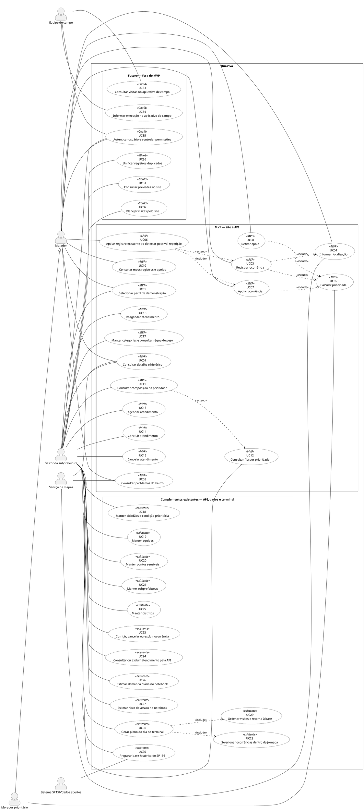

# RuaViva — Agile Methodology With Squad Framework

**FIAP · Global Solution 2026.2 · Equipe RuaViva**  
**Anthony Gonçalves Sforzin — RM 562096**  
**Cesar Aaron Herrera — RM 565398**  
**Território:** Liberdade, Rua Barão de Iguape, Subprefeitura Sé, São Paulo.  
**Referência da entrega:** arquivos do repositório consultados em 11/11/2026.

Este conteúdo reúne os seis itens da avaliação para composição de um PDF único. O diagrama tem sua estrutura em [casos-de-uso.json](casos-de-uso.json), e a tabela de histórias também está em [backlog.csv](backlog.csv), com separador `;`. O roteiro da seção 6 é material para gravar o vídeo com narração; não representa um vídeo já produzido. As telas citadas são as páginas de `web/`. Na montagem do PDF, inserir suas capturas e o diagrama renderizado junto dos comentários, além do link acessível do vídeo gravado.

## 1. Apresentação descritiva da ideia — 10 pontos

### Problema e recorte

Um bueiro entupido, uma calçada quebrada ou um buraco no asfalto muda o caminho de quem anda pela Rua Barão de Iguape. Para uma pessoa idosa com baixa visão, desviar pode significar pisar na rua sem conseguir avaliar o risco. Para quem trabalha no comércio, significa interromper o atendimento para registrar uma reclamação. Depois do registro, ambos precisam saber se alguém já avisou, se existe visita marcada e se o serviço foi concluído.

O RuaViva concentra esses registros em um mapa e uma lista do bairro, permite apoiar a ocorrência de um vizinho e organiza a fila da subprefeitura por critérios explícitos. O foco inicial é a Liberdade, com atenção à Rua Barão de Iguape, sob responsabilidade territorial da Subprefeitura Sé. Escolher esse recorte permite relacionar os registros a endereços concretos e comparar a jornada do morador com o trabalho do gestor. Não significa que o sistema já atenda toda a cidade ou que exista parceria operacional com a prefeitura.

### O que sustenta as escolhas

| Evidência do projeto | Consequência para o RuaViva |
|---|---|
| A base de 2025 preparada em Data Science contém **507.859 pedidos de zeladoria das 32 subprefeituras**. | A proposta parte de solicitações reais, e não apenas dos registros simulados da demonstração. Esse total é municipal, não da Liberdade. |
| No teste de **outubro a dezembro de 2025**, **87% dos 526 pedidos de “Calçadas, guias e postes” da Sé** não foram finalizados em até sete dias, percentual arredondado do notebook. | Idosos e pessoas com deficiência são público central. O número é da categoria agrupada e da subprefeitura; não é uma taxa exclusiva de calçadas da Barão de Iguape. “Atraso” nessa análise também inclui pedidos ainda abertos, exclui cancelados e usa corte estatístico de sete dias. |
| A análise de demanda identifica **segunda-feira como dia de pico**. | O planejamento deve considerar o ciclo da semana. A previsão existe no notebook, mas ainda não dimensiona equipes automaticamente no site. |
| A base demonstrativa do banco tem **15 ocorrências**, das quais **9 na Barão de Iguape**, com endereço, coordenadas, tipo e datas provenientes do SP156 do terceiro trimestre de 2026. | Há exemplos territoriais para demonstrar o fluxo. Esse retrato de 2026 é diferente da base estatística de 2025. Cidadãos, apoios, equipes, descrições e atendimentos são simulados. |

Fontes locais: [Data Science — README](../data-science/README.md), [notebook executado, análises da Sé e recomendações](../data-science/zeladoria_sp156.ipynb) e [Database — dados de exemplo](../database/README.md). Fonte pública original indicada nesses arquivos: [Dados do SP156, Prefeitura de São Paulo](https://dados.prefeitura.sp.gov.br/dataset/dados-do-sp156), licença CC0, sem dados pessoais dos solicitantes. Os números acima reproduzem o recorte documentado no projeto; não são uma nova medição de 2026.

### Público-alvo e solução

O público principal são moradores que dependem de ruas e calçadas utilizáveis, especialmente idosos, pessoas com deficiência e responsáveis por carrinhos de bebê. Comerciantes também podem registrar e apoiar como moradores. O gestor precisa comparar pendências, entender a prioridade e organizar visitas. A equipe de campo é beneficiária secundária: hoje o gestor registra os atendimentos por ela; uma interface própria está no backlog futuro.

O morador escolhe um perfil de demonstração, consulta problemas da Liberdade e registra categoria, localização e detalhes em três passos. Se aparecer um problema pendente da mesma categoria a até **60 metros**, pode apoiar o registro existente. O sistema sugere uma possível repetição; a pessoa decide se é o mesmo problema. Não há união automática de ocorrências.

O gestor recebe a fila de ocorrências **ABERTA e sem atendimento válido**, da maior para a menor prioridade. Visitas canceladas não retiram o caso dessa fila. Agendar muda o estado para **EM_ANDAMENTO**; concluir uma visita muda para **RESOLVIDA** e cancela outras visitas agendadas do mesmo caso. Cancelar o último agendamento devolve a ocorrência pendente para **ABERTA**. Cancelar uma ocorrência é uma operação distinta, disponível na API, e também cancela suas visitas agendadas.

A prioridade é calculada pela regra implementada em Java e reproduzida no banco:

> **Prioridade = peso da categoria × 10 + 2 por apoio + 15 se houver ponto sensível a até 200 m + 10 se o autor for prioritário (idoso/PcD).**

O peso varia de **1 a 5** e é definido pelo gestor. A régua é uma sugestão, não uma escolha feita pelo morador. A proximidade usa distância entre coordenadas, pela fórmula de Haversine; o bônus é aplicado uma vez, mesmo se houver vários pontos sensíveis próximos. Escola, creche, UBS, hospital, ILPI, terminal e estação de metrô são tipos previstos no banco. Quatro dos cinco pontos sensíveis da demonstração têm nomes fictícios e posições aproximadas; a Estação Japão–Liberdade é real, também com posição aproximada.

No exemplo inicial, o bueiro da **Rua Barão de Iguape, 288**, ocorrência 3, soma **71 pontos: 40 da categoria + 6 de três apoios + 15 da proximidade + 10 do autor prioritário**. O exemplo da API indica a escola fictícia mais próxima a aproximadamente 40 m. O detalhe da composição vem de `GET /ocorrencias/3/prioridade`; não é um texto fixo da interface. A pontuação de pendências é recalculada quando mudam apoios, peso, pontos sensíveis ou condição prioritária. Apoiar aumenta a pontuação, mas não garante data de atendimento.

### O que existe e o que permanece futuro

| Parte | Situação verificável no repositório |
|---|---|
| Site e API | HTML, CSS e JavaScript para entrada, mapa/lista, registro, detalhe, meus registros, fila e categorias. Spring Boot com Oracle implementa cadastros, apoios, prioridade e ciclo dos atendimentos. O funcionamento conectado depende da API e do banco disponíveis. |
| Entrada | Escolha de morador fictício ou gestor, guardada no navegador. **Não há autenticação nem autorização por conta no servidor.** Os atores do diagrama indicam responsabilidades de uso, não permissões já protegidas. |
| Administração complementar | A API oferece operações de consulta, cadastro, alteração e exclusão de recursos. Nem todas têm botão no site: cidadãos, equipes, pontos sensíveis, subprefeituras e distritos são administrados pela API. Reagendamento e manutenção de ocorrências também têm escopo específico de API. |
| Análise de dados | Notebook executado com regressão linear para demanda e logística para risco. MAE **11,6 pedidos/dia**; recall **0,85**, precisão **0,52**, AUC **0,82** no teste. Os escores logísticos servem como ordenação de risco, não como probabilidade exata calibrada. Não participam da prioridade atual. |
| Plano do dia | Programa de terminal implementado: seleciona serviços por jornada e ordena visitas com retorno à base. Lê o retrato local ou, opcionalmente, a API. No exemplo local: **3 serviços, 187 pontos e 7,36 h de uma jornada de 8 h**. Não grava atendimentos. O grafo é didático e a seleção seguida da rota não garante o melhor resultado conjunto possível. |
| Evoluções | Previsões no site, planejamento com agendamento pela tela, aplicativo da equipe, autenticação e unificação de duplicatas estão em **Could/Won’t**, sem marcação de MVP. Não há transmissão de protocolos ao SP156, navegação com trânsito ao vivo, fotos ou notificações implementadas. |

No planejador, o retrato local inclui cinco pendências ABERTA/EM_ANDAMENTO. Já o modo API usa a fila recebida, que retorna abertas sem atendimento: a ocorrência 5, já agendada no exemplo, fica fora. Assim, os dois modos podem gerar planos diferentes. A ferramenta planeja uma equipe por vez, não distribui automaticamente o trabalho entre várias equipes.

O prazo exibido ao morador é o **prazo de referência da categoria**, definido pela equipe do projeto; não é um compromisso oficial da prefeitura. Os sete dias do notebook são um corte único de análise e não substituem esse prazo. A base do SP156 registra solicitações: bairros que registram menos não necessariamente têm menos problemas, e uma solicitação “Finalizada” não comprova, por si só, o conserto em campo.

### Valor esperado e como observar

A proposta busca tornar o acompanhamento compreensível e dar visibilidade ao impacto coletivo. Para avaliar uma operação futura, acompanharíamos o tempo médio entre abertura e resolução e o percentual resolvido em até sete dias, sempre informando período e população analisada. O número de duplicatas unificadas, citado na ficha da CitizenTech, depende da funcionalidade futura US25: hoje há sugestão para apoiar, não medição de uniões. Não apresentamos redução de prazo ou de duplicidade como resultado já alcançado.

A relação com os ODS é concreta: **ODS 11**, pela conservação de caminhos e espaços urbanos; **ODS 10**, pela consideração de idosos e pessoas com deficiência no acesso e na prioridade; **ODS 9**, pelo uso de software e dados no planejamento da infraestrutura urbana. Essas relações expressam a intenção da solução, não impacto social medido.

## 2. Personas — 10 pontos

As personas abaixo são **composições fictícias para orientar o projeto**. Não representam entrevistas realizadas nem pessoas identificadas nos dados públicos. As citações são falas ilustrativas escritas pela equipe.

### Persona principal 1 — Helena Duarte, 74 anos, moradora com baixa visão

Helena mora na Liberdade e passa pela Barão de Iguape para fazer compras e chegar ao transporte. Tem baixa visão e amplia a letra no celular. Quando encontra um trecho quebrado, procura um lugar seguro para parar antes de mexer no aparelho. Usa a leitura do endereço como confirmação porque não distingue com facilidade marcadores pequenos no mapa.

**Objetivos:** avisar sobre uma barreira no caminho, reconhecer o endereço correto e saber se há visita marcada. **Frustrações:** letras pequenas, campos sem explicação, mapas que exigem precisão no toque e mensagens vagas como “em tratamento”. Ela não quer repetir uma reclamação para descobrir se foi esquecida.

**Como o RuaViva ajuda:** lista antes do mapa, texto de corpo de 18 px, fonte Atkinson Hyperlegible, endereço em placa azul e estados escritos por extenso. No registro, faz uma escolha por etapa e pode confirmar a rua em texto. Sua condição prioritária já cadastrada acrescenta dez pontos; não há promessa de atendimento imediato. No detalhe, a frase “Aguardando equipe” ou a data de visita comunica o fato disponível.

> “Quero enxergar onde registrei e saber se já marcaram uma visita.”

**Relação com o escopo:** A02 especializa A01; US02–US09, principalmente UC04, UC05 e UC09.

### Persona principal 2 — Rafael Nunes, 38 anos, morador e comerciante da Barão de Iguape

Rafael mora perto da loja em que trabalha na Rua Barão de Iguape. Abre o comércio cedo, recebe mercadorias e usa o celular entre um atendimento e outro. Ao ver lixo junto ao bueiro, tem poucos minutos para avisar e frequentemente segura uma sacola ou um pedido na outra mão.

**Objetivos:** registrar com poucos toques, apoiar o que já foi apontado e reencontrar os problemas que afetam a entrada da loja. **Frustrações:** repetir endereço e descrição, perder um formulário ao abrir outro registro e receber uma resposta que não informa nenhuma etapa concreta.

**Como o RuaViva ajuda:** botões grandes, categorias acompanhadas de exemplos, descrição opcional e resumo antes de enviar. Se houver um registro pendente da mesma categoria a até 60 m, pode apoiar sem abrir outro. O rascunho fica na sessão do navegador durante a consulta, quando esse armazenamento está disponível. “Meus registros” separa o que ele criou do que apoiou.

> “Se o vizinho já avisou desse bueiro, prefiro apoiar e voltar ao trabalho.”

**Relação com o escopo:** A01; US03–US08, especialmente UC06 e UC10. Não existe um perfil separado de comerciante.

### Persona principal 3 — Márcia Oliveira, 45 anos, gestora da Subprefeitura Sé

Márcia representa a pessoa que organiza a fila de zeladoria da Sé. Trabalha principalmente no computador e precisa comparar localização, tipo de serviço, apoios e tempo de espera antes de escolher uma equipe. Seu problema diário é justificar uma decisão com os recursos disponíveis, sem transformar cada pedido em uma conversa isolada.

**Objetivos:** identificar casos sem equipe, entender a composição da prioridade, marcar uma visita e registrar sua conclusão. **Frustrações:** listas que misturam pendências com atendimentos já agendados, números sem explicação e formulários que escondem a ocorrência que estava comparando.

**Como o RuaViva ajuda:** fila ordenada, endereço visível, número acompanhado do nível de prioridade e composição consultável. O agendamento abre na própria linha. Visitas agendadas ficam em uma área separada. Prazo vencido recebe texto e vermelho, sem depender só da cor. O notebook e o planejador de terminal fornecem análises complementares; ela ainda não encontra previsões nem geração automática de rotas dentro do site.

> “Preciso explicar por que este caso vem primeiro e ver quem ficou responsável pela visita.”

**Relação com o escopo:** A03; US10–US22 e US25. Cadastros sem tela e reagendamento são operações da API, não painéis já disponíveis.

### Persona secundária — João Batista, 51 anos, integrante da equipe de campo

João representa quem sai da base com uma equipe de zeladoria. Precisa localizar os serviços, saber a ordem das visitas e comunicar o que foi realizado. Um endereço impreciso pode fazê-lo perder tempo; uma sequência que ignora o retorno à base pode ultrapassar a jornada.

**Objetivos:** receber endereços claros, cumprir uma sequência viável e devolver o resultado da visita. **Frustrações:** deslocamentos repetidos, informação incompleta e planejamento que não considera tempo de serviço e viagem.

**Como o RuaViva ajuda hoje:** o gestor agenda a equipe e registra a conclusão. O programa de terminal permite ao gestor estudar um plano com ida, serviço e retorno. **Como poderá ajudar:** US23 prevê consulta de visitas e registro de execução no celular da própria equipe. Não há aplicativo de campo, atualização de posição nem navegação curva a curva prontos.

> “Preciso saber onde trabalhar e ter tempo para voltar à base.”

**Relação com o escopo:** A04; US23 e UC33–UC34, futuros. É uma persona secundária na priorização do produto, mas ator primário nesses casos futuros porque os inicia.

## 3. Casos de uso: escopo total e atores — 20 pontos

### Fronteira do sistema e legenda

A fronteira **RuaViva** inclui site, API, preparação local dos dados, notebook e planejador de terminal. SP156/dados abertos e Serviço de mapas ficam fora. O sistema representa tanto funcionalidades existentes quanto os cinco conjuntos de evolução explicitados no backlog. **Estar no diagrama não significa estar no MVP.** “Manter” significa listar, consultar por ID, cadastrar, atualizar e excluir quando as regras e os vínculos permitem.

| ID | Ator | Papel |
|---|---|---|
| A01 | Morador — primário | Registra, apoia e acompanha. |
| A02 | Morador prioritário — primário | Especialização de Morador: herda seus casos; a condição cadastrada participa da prioridade. |
| A03 | Gestor da subprefeitura — primário | Consulta fila, administra referências e atendimentos e usa análises. |
| A04 | Equipe de campo — primário | Terá interação direta no aplicativo futuro. Hoje o gestor opera o atendimento. |
| A05 | Sistema SP156/dados abertos — secundário | Fornece arquivos históricos para preparação local; não recebe protocolos do RuaViva. |
| A06 | Serviço de mapas — secundário | OpenStreetMap fornece mapa e Nominatim fornece busca e geocodificação reversa. GPS é um recurso do navegador, não desse serviço. |

### Catálogo de casos de uso

| ID | Caso de uso | Entrega e limite | Histórias |
|---|---|---|---|
| UC01 | Selecionar perfil de demonstração | Site · MVP | US01 |
| UC02 | Consultar problemas do bairro | Site · MVP | US02 |
| UC03 | Registrar ocorrência | Site/API · MVP | US03 |
| UC04 | Informar localização | Site/mapas · MVP | US03, US04 |
| UC05 | Calcular prioridade | API · MVP | US03, US06, US09, US15, US16 |
| UC06 | Apoiar registro existente ao detectar possível repetição | Site/API · MVP | US05 |
| UC07 | Apoiar ocorrência | Site/API · MVP | US05, US06 |
| UC08 | Retirar apoio | Site/API · MVP | US06 |
| UC09 | Consultar detalhe e histórico | Site/API · MVP | US07 |
| UC10 | Consultar meus registros e apoios | Site · MVP | US08 |
| UC11 | Consultar composição da prioridade | API e visão do gestor · MVP | US09, US10 |
| UC12 | Consultar fila por prioridade | Site/API · MVP | US10 |
| UC13 | Agendar atendimento | Site/API · MVP | US11 |
| UC14 | Concluir atendimento | Site/API · MVP | US12 |
| UC15 | Cancelar atendimento | Site/API · MVP | US13 |
| UC16 | Reagendar atendimento | API · MVP | US13 |
| UC17 | Manter categorias e consultar régua de peso | Cadastro/lista/régua no site, manutenção na API · MVP | US14 |
| UC18 | Manter cidadãos e condição prioritária | API · complementar | US15 |
| UC19 | Manter equipes | API · complementar | US16 |
| UC20 | Manter pontos sensíveis | API · complementar | US16 |
| UC21 | Manter subprefeituras | API · complementar | US16 |
| UC22 | Manter distritos | API · complementar | US16 |
| UC23 | Corrigir, cancelar ou excluir ocorrência | API · complementar | US17 |
| UC24 | Consultar ou excluir atendimento pela API | API · complementar | US17 |
| UC25 | Preparar base histórica do SP156 | Script/base local · complementar | US18 |
| UC26 | Estimar demanda diária no notebook | Notebook · complementar | US19 |
| UC27 | Estimar risco de atraso no notebook | Notebook · complementar | US19 |
| UC28 | Selecionar ocorrências dentro da jornada | Terminal · complementar | US20 |
| UC29 | Ordenar visitas e retorno à base | Terminal · complementar | US20 |
| UC30 | Gerar plano do dia no terminal | Terminal · complementar | US20 |
| UC31 | Consultar previsões no site | Futuro · Could | US21 |
| UC32 | Planejar visitas pelo site | Futuro · Could | US22 |
| UC33 | Consultar visitas no aplicativo de campo | Futuro · Could | US23 |
| UC34 | Informar execução no aplicativo de campo | Futuro · Could | US23 |
| UC35 | Autenticar usuário e controlar permissões | Futuro · Could | US24 |
| UC36 | Unificar registros duplicados | Futuro · Won’t nesta entrega | US25 |

### Relações e condições

| Relação UML | Significado no fluxo |
|---|---|
| UC03 Registrar ocorrência `<<include>>` UC04 Informar localização | Todo registro precisa de coordenadas, rua e bairro. |
| UC03 Registrar ocorrência `<<include>>` UC05 Calcular prioridade | A API calcula a pontuação na criação, sem pedir que o morador informe o valor. |
| UC06 Apoiar registro existente ao detectar possível repetição `<<extend>>` UC03 Registrar ocorrência | No passo de localização, se houver pendente da mesma categoria a até 60 m e o morador reconhecer o mesmo problema, pode apoiar e encerrar o fluxo sem novo registro. A sugestão não bloqueia um problema distinto. |
| UC06 `<<include>>` UC07 Apoiar ocorrência | A alternativa usa as mesmas validações do apoio comum. |
| UC07 Apoiar ocorrência `<<include>>` UC05 Calcular prioridade | Um apoio aceito altera a pontuação. |
| UC08 Retirar apoio `<<include>>` UC05 Calcular prioridade | Retirar um apoio também recalcula a pontuação. |
| UC11 Consultar composição `<<extend>>` UC12 Consultar fila | A explicação é aberta sob demanda pelo gestor; ler a fila não exige abrir todas as composições. UC11 também pode ser consultado no detalhe pelo gestor ou diretamente na API. |
| UC30 Gerar plano do dia `<<include>>` UC28 Selecionar ocorrências | A geração do plano executa a seleção dentro da jornada simulada. |
| UC30 Gerar plano do dia `<<include>>` UC29 Ordenar visitas e retorno | O plano calcula a ordem e confere o retorno à base. |

Na generalização, a seta sai de **A02 para A01**, com triângulo vazio em A01. Em `include`, a seta vai do caso que usa para o caso incluído; em `extend`, sai da extensão e aponta para o caso base. As associações ator–caso não representam ordem de execução. UC05 é uma operação interna associada ao benefício do morador prioritário; ele não edita a fórmula nem declara o bônus a cada registro.

Outras dependências são regras, não relações UML obrigatórias: alterar peso, ponto sensível ou condição prioritária pode recalcular pendências; os modelos consomem a base já preparada; a rota consome prioridades já calculadas. Não desenhamos `include` entre análise e importação porque o notebook pode usar o arquivo existente sem importar novamente.

### Diagrama completo — fonte para renderização

O JSON usa os mesmos IDs e relações do diagrama abaixo. No PDF, renderizar em página de paisagem com texto legível; a legenda distingue MVP, complementos existentes e futuro. Não usar apenas uma imagem das três telas do morador como se fosse o escopo completo.

## 4. Backlog do produto — 20 pontos

### Priorização e estimativas

**Must** reúne o núcleo demonstrável: registrar, localizar, evitar repetição por apoio, acompanhar e gerir atendimentos com prioridade explicável. **Should** reúne complementos já implementados na API, nos dados ou no terminal, fora do recorte mínimo da demonstração. **Could** reúne integrações e experiências ainda futuras. **Won’t** significa fora desta entrega, sem compromisso de implementação agora. Conforme o recorte desta entrega, nenhum recurso ainda inexistente recebe Must ou Should.

**MVP = sim** identifica somente o escopo já implementado explicitado nos critérios, incluindo operações cuja forma de uso é a API. Essa marca não significa implantação pública nem teste com usuários reais. Reagendar existe na API, por exemplo, mas não é apresentado como botão disponível no site. **MVP = não** pode significar complemento existente ou futuro; a coluna MoSCoW e o catálogo da seção 3 distinguem esses casos.

Os pontos foram estimados com **Planning Poker** entre Anthony e Cesar, usando cartas Fibonacci **1, 2, 3, 5, 8 e 13**: cada um lê os critérios, escolhe uma carta sem mostrar, os dois revelam ao mesmo tempo, discutem as diferenças e votam de novo até chegar a um valor comum. Pontos comparam esforço, regras e incerteza; não são horas nem dias. Como referência, escolher perfil tem 2 pontos, dar/retirar apoio tem 3, localizar com alternativas tem 5 e registrar em etapas tem 8. Itens de 13 pontos são divididos em tarefas menores antes da execução. Sessão realizada em DATA_PLANNING.

### Histórias e critérios

As linhas em **negrito** compõem o MVP. Os mesmos textos, prioridades, pontos e critérios constam no CSV; IDs UC separados por vírgula indicam rastreabilidade, não sequência de passos.

| ID | História de usuário | UCs | MoSCoW | Pontos | MVP | Critérios de aceitação |
|---|---|---|---|---:|---|---|
| **US01** | Como Morador, quero escolher um perfil de demonstração, para experimentar os registros do bairro. | UC01 | Must | 2 | **sim** | Listar moradores da API e exigir escolha. Guardar perfil no navegador. Oferecer entrada de gestor e informar que não é login. |
| **US02** | Como Morador, quero consultar problemas em lista e mapa, para reconhecer o que já foi registrado na Liberdade. | UC02 | Must | 5 | **sim** | Filtrar Pendentes, Resolvidos e Todos. Listar apenas a Liberdade. Usar os mesmos números na lista e no mapa. |
| **US03** | Como Morador, quero registrar um problema em três passos, para enviar categoria, local e detalhes sem preencher tudo de uma vez. | UC03,UC04,UC05 | Must | 8 | **sim** | Exigir categoria, coordenadas, rua e bairro. Aceitar descrição opcional na tela e enviar nome da categoria se vazia. API criar ABERTA com data de hoje e prioridade calculada. Mostrar confirmação. |
| **US04** | Como Morador, quero localizar o problema por endereço, GPS ou mapa, para indicar onde a equipe deve trabalhar. | UC04 | Must | 5 | **sim** | Buscar endereço na região e oferecer resultados em texto. Permitir ajuste do ponto e marcação do centro com teclado. Confirmar local em texto e permitir informar rua se a busca falhar. |
| **US05** | Como Morador, quero apoiar um registro parecido durante o cadastro, para evitar abrir outro pedido sobre o mesmo problema. | UC06,UC07 | Must | 5 | **sim** | Sugerir pendentes da mesma categoria a até 60 m. Apoiar só após escolha do morador e sem criar nova ocorrência. Guardar rascunho na sessão. Não unir registros automaticamente. |
| **US06** | Como Morador, quero dar ou retirar meu apoio, para manter atualizada a indicação de que o problema também me afeta. | UC07,UC08,UC05 | Must | 3 | **sim** | Impedir apoio próprio, repetido ou a ocorrência encerrada. Criar apoio por POST e retirar por DELETE. Recalcular prioridade após alteração. |
| **US07** | Como Morador, quero consultar situação, prazo de referência e histórico do problema, para saber o que já aconteceu e qual é a próxima etapa. | UC09 | Must | 5 | **sim** | Exibir endereço, status, visitas e datas disponíveis. Distinguir agendamento de deslocamento em curso. Comparar prazo da categoria sem prometer atendimento em sete dias. |
| **US08** | Como Morador, quero separar os problemas que registrei dos que apoiei, para reencontrar os pedidos que acompanho. | UC10 | Must | 3 | **sim** | Filtrar autor e apoios pelo perfil selecionado. Exibir duas seções com acesso ao detalhe. Mostrar convite para agir nas listas vazias. |
| **US09** | Como Morador prioritário, quero que minha condição cadastrada participe da prioridade, para que o impacto sobre idosos e pessoas com deficiência seja considerado. | UC05,UC11 | Must | 5 | **sim** | Somar peso × 10, 2 por apoio, 15 se houver ponto sensível a até 200 m e 10 pelo autor prioritário. Aplicar bônus de proximidade uma vez. Expor composição via API. |
| **US10** | Como Gestor da subprefeitura, quero consultar uma fila ordenada e entender a pontuação, para comparar os casos que ainda aguardam equipe. | UC12,UC11 | Must | 5 | **sim** | Listar ABERTA sem atendimento válido em ordem decrescente de prioridade. Desconsiderar visitas canceladas. Consultar composição sem alterar dados. |
| **US11** | Como Gestor da subprefeitura, quero agendar uma equipe para um problema, para organizar o atendimento. | UC13 | Must | 5 | **sim** | API aceitar só ocorrência pendente, equipe ativa e data não anterior à abertura. Mudar ABERTA para EM_ANDAMENTO. Na tela, oferecer equipes da mesma subprefeitura e data a partir de hoje. |
| **US12** | Como Gestor da subprefeitura, quero registrar a conclusão de uma visita, para atualizar a situação que o morador acompanha. | UC14 | Must | 5 | **sim** | Concluir apenas atendimento AGENDADO. Registrar execução e observação opcional. Marcar ocorrência RESOLVIDA e cancelar outras visitas agendadas para ela. |
| **US13** | Como Gestor da subprefeitura, quero cancelar ou reagendar uma visita, para ajustar o trabalho sem perder o histórico. | UC15,UC16 | Must | 5 | **sim** | Cancelar visita pela tela ou API. Reagendar pela API apenas AGENDADO. Ao cancelar a última visita, devolver ocorrência EM_ANDAMENTO para ABERTA. Não editar visitas encerradas. |
| **US14** | Como Gestor da subprefeitura, quero manter categorias com peso, prazo e horas, para aplicar referências consistentes aos registros. | UC17 | Must | 3 | **sim** | Cadastrar e listar na tela. Consultar régua opcional e validar peso de 1 a 5. Editar ou excluir pela API respeitando vínculos. Recalcular pendentes se o peso mudar. |
| US15 | Como Gestor da subprefeitura, quero manter cidadãos e sua condição prioritária pela API, para corrigir os dados usados nos registros. | UC18,UC05 | Should | 3 | não | Listar, consultar, cadastrar, atualizar e excluir respeitando vínculos. Exigir email único. Omitir prioritario no PUT preserva valor. Recalcular pendentes após alteração relevante. |
| US16 | Como Gestor da subprefeitura, quero manter equipes, pontos sensíveis e territórios pela API, para sustentar o atendimento e o cálculo de proximidade. | UC19,UC20,UC21,UC22,UC05 | Should | 13 | não | Oferecer consulta, cadastro, edição e exclusão dos quatro recursos com vínculos válidos. Manter equipe ativa, base e horas. Recalcular pendentes ao alterar pontos sensíveis. |
| US17 | Como Gestor da subprefeitura, quero corrigir registros e administrar exclusões pela API, para tratar erros de cadastro conforme as regras do histórico. | UC23,UC24 | Should | 5 | não | Corrigir ocorrência pendente sem trocar autor ou abertura. Cancelar também suas visitas agendadas. Recusar edição de ocorrência encerrada e exclusão de ocorrência resolvida ou atendimento concluído. Respeitar vínculos do banco. |
| US18 | Como Gestor da subprefeitura, quero consultar uma base histórica preparada do SP156, para fundamentar o planejamento em solicitações reais. | UC25 | Should | 5 | não | Preparar os quatro trimestres de 2025 com script local. Identificar fonte e período dos 507.859 pedidos. Não importar cidadãos nem transmitir protocolos ao SP156. |
| US19 | Como Gestor da subprefeitura, quero analisar demanda e risco no notebook, para identificar períodos e tipos de pedido que exigem atenção. | UC26,UC27 | Should | 8 | não | Treinar em jan-set e testar em out-dez de 2025. Relatar MAE 11,6 e recall 0,85 com precisão 0,52. Explicar corte de sete dias e risco não calibrado. Não inserir previsões na fila atual. |
| US20 | Como Gestor da subprefeitura, quero gerar um plano do dia no terminal, para selecionar serviços e ordenar visitas dentro da jornada simulada. | UC28,UC29,UC30 | Should | 13 | não | Ler retrato local ou fila da API. Respeitar jornada com serviço, deslocamento e retorno. Mostrar seleção, horários e adiados. Não gravar atendimentos nem prometer ótimo global de seleção e rota. |
| US21 | Como Gestor da subprefeitura, quero consultar previsões dentro do site, para usar a análise sem abrir o notebook. | UC31 | Could | 8 | não | Futuro: integrar resultados por região e data. Exibir métricas, período e limitações. Manter previsão de risco separada da pontuação vigente. |
| US22 | Como Gestor da subprefeitura, quero gerar e revisar um plano de visitas no site, para transformar uma simulação aprovada em agendamentos. | UC32 | Could | 13 | não | Futuro: integrar planejador à tela. Conferir equipes, jornada e visitas existentes. Gravar somente após confirmação do gestor e tratar conflitos. |
| US23 | Como Equipe de campo, quero consultar minhas visitas e informar a execução pelo celular, para devolver ao gestor o resultado do serviço no local. | UC33,UC34 | Could | 8 | não | Futuro: mostrar visitas atribuídas à equipe autenticada. Registrar o que foi feito e data. Aplicar ciclo de atendimento da API. Hoje a conclusão é lançada pelo gestor. |
| US24 | Como Morador, quero entrar com uma conta protegida e permissões por perfil, para que apenas pessoas autorizadas alterem meus dados. | UC35 | Could | 13 | não | Futuro: autenticar morador, gestor e equipe de campo. Validar permissões no servidor. Substituir seleção de perfil local como mecanismo de acesso. |
| US25 | Como Gestor da subprefeitura, quero unificar ocorrências confirmadas como duplicadas, para manter um histórico comum sem contar o mesmo apoio duas vezes. | UC36 | Won’t | 13 | não | Futuro fora desta entrega: exigir revisão humana, preservar origem e histórico e deduplicar apoios por cidadão. O aviso de proximidade atual não executa essa união. |

**Resumo do recorte:** 14 histórias Must no MVP, somando 64 pontos; 6 histórias Should de complementos existentes; 4 Could e 1 Won’t de evolução futura. Pontos são estimativas, não uma medida de produtividade da dupla.

### Organização da Equipe RuaViva

A dupla cobre produto, interface, dados e implementação. Como proposta de organização desta entrega, Anthony conduz a revisão das personas, da jornada e da apresentação; Cesar conduz a revisão das regras, dos dados e da rastreabilidade técnica. Ambos revisam o resultado e narram o pitch. Essa divisão descreve responsabilidades sugeridas, sem atribuir autoria de código ou rituais anteriores não documentados.

O quadro de trabalho pode usar A fazer, Em andamento, Em revisão e Concluído, com no máximo uma atividade em execução por integrante. Uma história só entra em Concluído depois de demonstrar seus critérios no componente declarado, revisar textos e conferir se casos de uso, backlog e tela dizem a mesma coisa. Uma tarefa visual pronta não conclui, sozinha, uma integração com a API.

Para a próxima conversa de planejamento, revisar primeiro as dependências: US03 depende de localização e prioridade; US05 usa as regras de US06; a fila precede o agendamento; autenticação e permissões são necessárias antes de oferecer acesso próprio da equipe de campo. As integrações futuras não são compromissos de prazo nem resultados já entregues.

## 5. Protótipo e comentários de UX — 20 pontos

### Linguagem visual e adequação ao público

O protótipo de referência é o próprio conjunto de páginas HTML de `web/`, orientado por [DESIGN.md](../web/DESIGN.md). A linguagem é a **sinalização de rua de São Paulo**: o endereço recebe forma de placa porque é a informação que liga o relato a um lugar. O bairro aparece pelo nome e pelo mapa, sem ornamentação temática. A intenção é facilitar reconhecimento e leitura.

O azul placa **#1A4D8F** identifica endereço, marca e navegação. O amarelo faixa **#F2C200** destaca a ação principal da etapa. O vermelho **#C8102E** indica urgência, atraso ou erro; o verde **#1E7D4F**, resolução ou sucesso; o âmbar indica andamento. Status sempre têm texto. A tipografia Barlow Semi Condensed dá forma aos títulos e números; Atkinson Hyperlegible é usada no corpo de 18 px, com mínimo previsto de 16 px. O texto secundário em #4A5961 sobre branco tem contraste de 6,9:1 documentado no design.

Para Helena e Rafael, a interface propõe uma decisão por vez, rótulos claros, alvos de toque de pelo menos 48 px e botões principais de pelo menos 52 px. A possibilidade de usar uma mão orienta o tamanho e a distribuição das ações. Os marcadores de 36 px são complementados pela lista, cujas linhas inteiras são links. Para Márcia, o desktop prioriza comparação por linhas e números alinhados.

Há link “Pular para o conteúdo”, foco visível, campos com rótulos, instruções ligadas por `aria-describedby`, avisos anunciados com `aria-live` e erros que recebem foco. A meta de uso em 320 px e com zoom de 200%, assim como a navegação por teclado e leitor de tela, deve ser conferida na apresentação do protótipo. Esses recursos e metas não equivalem a uma certificação de acessibilidade nem substituem testes com idosos e pessoas com baixa visão. A animação prevista limita-se à confirmação de envio e respeita redução de movimento.

### T01 — Entrada

**Página:** [index.html](../web/index.html). **Personas:** Helena, Rafael e Márcia. **Rastreabilidade:** UC01 / US01.

**O que mostrar na captura:** placa RuaViva, “Liberdade · Sé · São Paulo”, apresentação curta, seleção de morador da demonstração, entrada de gestor e nota sobre dados simulados.

**Intenção:** esclarecer o serviço antes de pedir uma ação. Os dois caminhos distinguem quem registra de quem organiza visitas. O botão de morador tem destaque amarelo, e o caminho do gestor usa botão secundário. No celular, ficam um abaixo do outro.

**Adequação:** Helena encontra uma frase direta e uma escolha com rótulo; Rafael não precisa preencher um cadastro para experimentar. A nota de demonstração impede interpretar a escolha de perfil como uma conta municipal real. Carregamento e indisponibilidade dos moradores têm mensagens e possibilidade de nova tentativa. Autenticação é US24, futura.

**Comentário para acompanhar a imagem no PDF:** “Escolher um perfil permite conhecer o fluxo. A entrada deixa visível que moradores e atendimentos são simulados; não é uma tela de login.”

### T02 — Mapa do bairro

**Página:** [mapa.html](../web/mapa.html). **Personas:** Helena e Rafael. **Rastreabilidade:** UC02 / US02.

**O que mostrar na captura:** título “Problemas no bairro”, contagem atual, filtros Pendentes / Resolvidos / Todos e a correspondência numérica entre lista e mapa. Fazer uma captura móvel com lista e outra de desktop ou da alternância Mapa, se houver espaço.

**Intenção:** permitir verificar o que já foi registrado antes de criar outro pedido. A contagem é calculada a partir da resposta da API; não escrever “5 problemas” como se fosse um número permanente. O filtro Pendentes reúne ABERTA e EM_ANDAMENTO; cancelados aparecem apenas em Todos.

**Adequação:** a lista vem primeiro no celular porque categoria, endereço e status podem ser lidos sem interpretar um mapa. No desktop, lista à esquerda e mapa à direita ajudam a comparar lugares. Números conectam as duas vistas; legenda e selos escritos evitam depender só de cor. A linha inteira abre o detalhe, oferecendo um alvo maior que o marcador.

**Comentário para o PDF:** “O mapa localiza; a lista permite ler e agir. Essa alternativa atende quem usa zoom, tem baixa visão ou está com pressa.”

### T03 — Registrar problema, três passos na mesma página

**Página:** [registrar.html](../web/registrar.html). **Personas:** Helena e Rafael. **Rastreabilidade:** UC03–UC07 / US03–US05 e US09. Capturar os três estados como T03a, T03b e T03c; são etapas de uma tela, não três produtos distintos.

**T03a — O que é?** A pessoa escolhe uma categoria por meio de uma opção grande com ícone, nome e exemplo, como “Tapa-buraco — buraco no asfalto da rua”. O indicador “1. Problema, 2. Local, 3. Detalhes” torna a duração do fluxo previsível. Ao escolher, a tela mostra o prazo de referência e que o atendimento é da Subprefeitura Sé, e um aviso lembra que risco imediato vai para a Defesa Civil (199). A intenção é evitar que o usuário precise conhecer a classificação administrativa do serviço. O morador escolhe a categoria, nunca o peso de gravidade.

**T03b — Onde fica?** A busca por “Rua e número” devolve opções textuais do Nominatim na região. Há alternativas de GPS, toque/arraste do ponto e setas do teclado seguidas de “Marcar o centro do mapa”. O local escolhido é confirmado em texto, com rua e número quando disponíveis; se a busca reversa falhar, a interface informa coordenadas e pede a rua. Número é opcional. O bairro precisa ser confirmado; a lista do bairro é focada na Liberdade, mas o formulário carrega os distritos da API. A busca regional não é uma restrição territorial aplicada a toda coordenada recebida pelo sistema.

Essa combinação permite a Helena confirmar o endereço sem depender da visão do marcador e a Rafael usar uma referência conhecida. Negar acesso ao GPS não deve impedir o registro. Quando há pendente da mesma categoria a até 60 m, aparece a pergunta “Alguém já registrou isso?” e, quando permitido, “Apoiar este em vez de registrar”. O rascunho usa `sessionStorage`, não salvamento permanente em conta ou sincronização entre aparelhos. O alerta pede reconhecimento humano: proximidade não prova duplicidade.

**T03c — Detalhes.** Descrição opcional, contador de até 500 caracteres e resumo do envio reduzem o esforço e permitem corrigir uma rua ou categoria equivocada. Como a API exige descrição, o código envia o nome da categoria quando a pessoa deixa esse campo vazio. “Voltar” mantém os dados, e “Enviar registro” é a ação principal. Durante o envio, o botão fica desabilitado e indica processamento. A confirmação exibe o endereço e explica que o registro entrou na fila e poderá ser acompanhado.

**Adequação do conjunto:** uma decisão por etapa reduz a quantidade de informação simultânea; os títulos recebem foco ao avançar e os erros são apresentados em linguagem direta. A confirmação trata de um registro realizado, sem afirmar que a equipe saiu da base. Não há campo de foto, gravação de voz ou promessa de protocolo oficial SP156.

**Comentários para o PDF:** T03a: “Escolher pelo exemplo reduz dúvida sobre a categoria.” T03b: “O endereço em texto confirma o ponto; o apoio pode evitar um novo pedido.” T03c: “O resumo permite revisar antes de enviar, com descrição opcional e confirmação clara.”

### T04 — Detalhe do problema

**Página:** [ocorrencia.html](../web/ocorrencia.html), com parâmetro de ID, por exemplo `?id=3`. **Personas:** Helena, Rafael e Márcia. **Rastreabilidade:** UC07–UC09 e UC11 / US06–US07 e US09–US10.

**O que mostrar na captura:** placa do endereço, categoria, status, situação atual, prazo da categoria, linha do tempo, apoio e mapa pequeno ao final. Para o exemplo de 71 pontos, usar a visão do gestor, que contém a composição da prioridade.

**Intenção:** responder primeiro “em que situação está?”. A situação aparece como a “Linha do atendimento”, inspirada no diagrama de linhas do Metrô de São Paulo: estações Registrado, Na fila, Visita agendada e Resolvido, com a atual destacada e as datas que o sistema tem. Quem não enxerga bem lê o mesmo conteúdo em texto, e o leitor de tela anuncia a estação atual. Frases como “Aguardando equipe”, “Visita agendada para…” e “Resolvido em…” vêm dos dados. O texto não transforma visita agendada em rastreamento da equipe. Quando o sistema não informa a data de cancelamento, a linha do tempo declara essa ausência em vez de inventar uma data.

**Adequação:** o endereço grande ajuda Helena a confirmar que abriu o problema certo. A situação vem antes do mapa, e a próxima etapa explica o estado sem termos técnicos. Rafael encontra o apoio com a expressão “Isso também me afeta”, a contagem e a explicação de seu efeito. Quem é autor não pode apoiar o próprio registro; quem já apoiou pode retirar o apoio enquanto a tela apresenta essa ação. Registros encerrados não recebem novos apoios. A composição numérica é oferecida ao gestor; não prometemos que o morador veja esse painel.

**Comentário para o PDF:** “A situação informa fatos disponíveis, o prazo é uma referência e o apoio indica impacto. Nenhum desses elementos promete uma data de conserto.”

### T05 — Fila do gestor

**Página:** [gestor.html](../web/gestor.html). **Persona:** Márcia. **Rastreabilidade:** UC11–UC15 / US10–US13. UC16, reagendamento, está na API, sem botão próprio nesta tela.

**O que mostrar na captura:** resumo textual, fila com prioridade, problema, endereço, apoios e prazo, uma linha aberta para agendamento e a área de visitas agendadas. Usar a ocorrência 3 como exemplo se o banco ainda estiver no estado inicial; valores e posição podem mudar com novos apoios e atendimentos.

**Intenção:** comparar vários casos antes de abrir o formulário de um deles. A área principal ocupa aproximadamente dois terços do desktop; visitas agendadas ficam ao lado. O número da prioridade recebe nível escrito: Alta a partir de 60, Média a partir de 40 e Baixa abaixo de 40. Essa classificação visual não altera a fórmula. A composição explica o número com dados da API.

**Adequação:** linhas alinhadas facilitam leitura rápida. O formulário abre dentro da linha escolhida, sem modal, mantendo endereço e problema no contexto. A equipe começa sem seleção, e a tela oferece equipes ativas da mesma subprefeitura. A data tem mínimo hoje na interface; a regra da API exige data não anterior à abertura. Essa diferença precisa ser preservada na descrição do produto.

“Marcar como resolvido” abre confirmação na própria visita com o campo “O que foi feito”. “Cancelar visita” é uma ação distinta e não deve ser descrita como exclusão do problema. Vermelho destaca atraso ou alta prioridade e vem acompanhado de palavras. Apenas uma linha de agendamento fica aberta por vez, evitando formulários concorrentes e excesso de ações amarelas.

**Comentário para o PDF:** “O gestor compara a fila, entende a pontuação e agenda no contexto do caso. Visitas já marcadas ficam separadas dos problemas que ainda aguardam equipe.”

### Telas complementares e sequência de apresentação

[Meus registros](../web/minhas.html) sustenta US08 com duas listas, autoria e apoio, e convites para agir quando estão vazias. [Categorias](../web/categorias.html) sustenta US14 com cadastro, tabela e régua de gravidade opcional; editar ou excluir categorias são operações da API. Essas duas telas completam a rastreabilidade, embora as cinco telas comentadas acima já ultrapassem o mínimo de três.

No PDF, apresentar Entrada → Mapa → Registrar (três estados) → Detalhe → Fila. Usar capturas do protótipo real e legendas desta seção, preservando o aviso de demonstração. A imagem da fila deve ser em desktop; as do morador, preferencialmente em largura de celular. Antes de capturar, verificar API disponível, exemplos legíveis, foco, mensagens de erro, zoom e a correspondência entre números da lista e do mapa. Não preencher capturas com previsões, fotos ou controles inexistentes para parecer uma versão mais completa.

## 6. Vídeo pitch com narração — 20 pontos

### Roteiro de até três minutos

**Duração planejada: 3:00, incluindo abertura e encerramento.** As falas abaixo foram escritas para alternar Anthony e Cesar, com ritmo aproximado de 125–135 palavras por minuto. Ensaiar com cronômetro, preservar pequenas pausas e cortar silêncio entre capturas se necessário. As falas são o texto narrado; as instruções de tela não devem ser lidas. Não inserir uma vinheta adicional fora do tempo previsto.

| Tempo | Narração | O que aparece na tela |
|---|---|---|
| **0:00–0:20** | **Anthony:** “Na Rua Barão de Iguape, na Liberdade, um bueiro entupido ou uma calçada quebrada atrapalha quem caminha e quem trabalha. Depois de avisar, o morador ainda precisa descobrir se já existe outro registro e se alguém marcou uma visita. Esse é o problema do RuaViva.” | Placa RuaViva, território completo e os dois nomes com RMs. Em seguida, lista e mapa da Liberdade com um endereço legível. Manter indicação de demonstração. |
| **0:20–0:45** | **Cesar:** “Analisamos 507.859 pedidos de zeladoria de 2025. Na Sé, 87% dos pedidos de calçadas, guias e postes do teste de outubro a dezembro não foram finalizados em até sete dias. Segunda-feira é o pico de demanda. Esses dados orientam nosso foco em acompanhamento e prioridade para quem enfrenta mais barreiras.” | Trechos do notebook com total, tabela da Sé e demanda por dia. Legenda: “SP156 · 2025 · 32 subprefeituras”; no percentual, “Sé · out–dez/2025 · 526 pedidos · cancelados excluídos”. Explicar visualmente: sete dias é corte de análise. |
| **0:45–1:05** | **Anthony:** “Pensamos em Helena, uma moradora idosa com baixa visão, e Rafael, que usa o celular entre os atendimentos da loja. A entrada separa morador e gestor. A lista aparece antes do mapa, com letras grandes, status escritos e endereços em placas azuis, como na rua.” | Personas identificadas como fictícias, sem sugerir depoimentos reais. Entrada e Mapa em largura móvel. Destacar endereço, status com texto, filtros e alternância Lista/Mapa. |
| **1:05–1:30** | **Cesar:** “Registrar tem três passos: escolher o problema, confirmar o local e revisar os detalhes. Podemos buscar um endereço ou marcar o mapa. Se houver um registro pendente da mesma categoria a até sessenta metros, o morador pode apoiar em vez de repetir. A descrição é opcional, e a confirmação explica como acompanhar.” | Gravação das três etapas de Registrar. Mostrar sugestão de repetição em um exemplo separado e voltar ao fluxo de envio de um problema distinto. Não apoiar e depois registrar intencionalmente a mesma ocorrência como se fosse necessário. |
| **1:30–1:50** | **Anthony:** “No detalhe, o RuaViva informa o que existe no sistema: aguardando equipe, visita agendada ou resolução registrada. A linha do tempo mostra o atendimento. O apoio diz que o problema também afeta outras pessoas. Ele entra na prioridade, mas não promete que o conserto acontecerá mais rápido.” | Detalhe de ocorrência, situação, prazo de referência, histórico e botão de apoio. Se mostrar visita agendada, usar a data real presente na demonstração. Não usar animação de veículo ou rastreamento. |
| **1:50–2:15** | **Cesar:** “O gestor compara os casos sem atendimento. Este bueiro tem 71 pontos: quarenta pela categoria, seis por três apoios, quinze pela proximidade de um ponto sensível e dez pelo autor prioritário. A composição explica a decisão. Na mesma tela, o gestor agenda uma equipe e registra a conclusão da visita.” | Fila e composição da ocorrência 3, no estado inicial, com soma **40 + 6 + 15 + 10 = 71**. Identificar escola como fictícia. Abrir agendamento e mostrar a área de visitas. A conclusão pode aparecer em corte separado para não alterar o exemplo antes da explicação. |
| **2:15–2:40** | **Anthony:** “Também temos um notebook para estimar demanda e risco de atraso, e um programa de terminal que seleciona serviços e ordena visitas dentro da jornada, incluindo o retorno à base. São componentes separados do site. Integrar previsões, planejar pela tela e oferecer acesso próprio à equipe de campo são próximos passos, não recursos prontos.” | Notebook e saída real documentada do terminal: três serviços, 187 pontos, 7,36 horas. Legenda “simulação didática; não grava agendamentos”. Mostrar US21–US24 como Could e fora do MVP. |
| **2:40–3:00** | **Cesar:** “O RuaViva conecta um problema localizado, o impacto nos moradores e a organização do atendimento. Queremos acompanhar tempo de resolução e pedidos resolvidos em até sete dias, sem anunciar resultados que ainda não medimos. Somos Anthony Gonçalves Sforzin e Cesar Aaron Herrera, Equipe RuaViva, da FIAP.” | Visão resumida Morador → registro/apoio → fila → visita → acompanhamento. Fechar com nomes, RMs, território e endereço do repositório: github.com/0x4aron/RuaViva. Encerrar até 3:00. |

### Preparação e identificação da entrega

Gravar a narração dos dois integrantes em ambiente silencioso e manter o áudio inteligível. A gravação deve mostrar o site com API disponível e dados de demonstração; os números iniciais podem mudar após um apoio ou agendamento. Para explicar os 71 pontos, usar o estado inicial conferido ou uma captura claramente identificada desse exemplo. Mostrar falhas como falhas ou repetir a captura depois de resolvê-las, sem apresentar telas estáticas como operações executadas.

O PDF único deve conter as seções 1 a 6, o diagrama renderizado com todos os atores, a tabela do backlog com o destaque de MVP, as capturas comentadas e o link do vídeo final com acesso de visualização. O repositório não substitui esse link. Este arquivo entrega o conteúdo e o roteiro; não afirma que o PDF foi exportado ou que o vídeo já foi gravado.

**Fontes de coerência da entrega:** [Ficha da CitizenTech](../README.md), [sistema de design](../web/DESIGN.md), páginas e scripts de [web](../web/), [regras e endpoints Java](../java-api/README.md), [banco e prioridade](../database/README.md), [Data Science](../data-science/README.md) e [programação dinâmica](../dynamic-programming/README.md).
