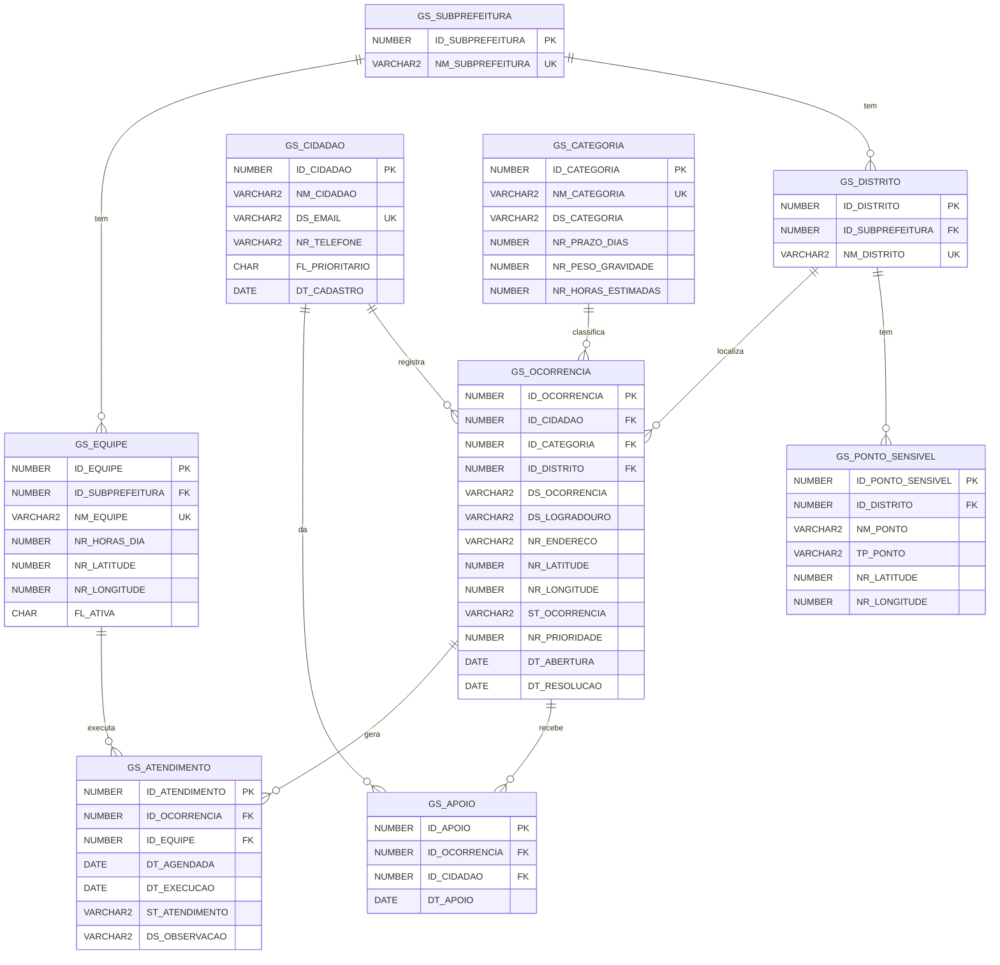

# Database Design — modelo de dados

Banco: **Oracle** (servidor da FIAP). Os scripts usam sintaxe compatível com Oracle 19c ou superior e foram testados localmente no Oracle XE 21. Este modelo também é a base da API Java (`java-api/`).

> **Atenção antes de rodar no Oracle da FIAP:** o usuário de vocês pode ter tabelas de GS anteriores com prefixo `GS_`. Antes de rodar o `00_drop.sql`, confiram:
> `SELECT table_name FROM user_tables WHERE table_name LIKE 'GS%';`
> O drop só apaga as 9 tabelas listadas abaixo. Mesmo assim, se alguma delas tiver o mesmo nome de uma tabela antiga de vocês, a antiga será apagada.

## Scripts

| Arquivo | Conteúdo |
|---|---|
| [`00_drop.sql`](00_drop.sql) | Apaga as tabelas, para recriar do zero |
| [`01_ddl.sql`](01_ddl.sql) | `CREATE TABLE` (PK, UNIQUE, CHECK) e `ALTER TABLE` (FKs) |
| `02_dml.sql` | _em breve_: `INSERT` com no mínimo 5 linhas por tabela |
| `03_dql.sql` | _em breve_: as 3 consultas pedidas |

Ordem de execução: `00_drop.sql` (só se as tabelas já existirem) → `01_ddl.sql` → `02_dml.sql` → `03_dql.sql`.

## Tabelas

| Tabela | Para que serve |
|---|---|
| `GS_SUBPREFEITURA` | Subprefeituras da cidade (ex.: Sé) |
| `GS_DISTRITO` | Distritos/bairros oficiais (ex.: Liberdade) |
| `GS_CATEGORIA` | Tipos de problema, com prazo, gravidade (1–5) e horas de trabalho estimadas |
| `GS_CIDADAO` | Quem registra e apoia (dados simulados). `FL_PRIORITARIO = 'S'` para idoso/PcD |
| `GS_PONTO_SENSIVEL` | Escola, creche, UBS, hospital, ILPI (casa de repouso para idosos) ou terminal de ônibus. Uma ocorrência perto deles ganha prioridade |
| `GS_EQUIPE` | Equipe de campo, com horas por dia e ponto de saída (lat/long) |
| `GS_OCORRENCIA` | O problema registrado: local, status e prioridade |
| `GS_APOIO` | "Também me afeta": cada cidadão apoia uma ocorrência uma única vez |
| `GS_ATENDIMENTO` | Visita agendada ou concluída de uma equipe a uma ocorrência |

## Diagrama (rascunho)

O diagrama oficial da entrega deve ser gerado no **Oracle Data Modeler**:
`File → Import → DDL File → 01_ddl.sql`. Ele monta as tabelas e os relacionamentos automaticamente.

## Como os dados se ligam ao resto do projeto

- **Prioridade (Java):** a camada BO calcula `NR_PRIORIDADE` a partir de quatro coisas: o peso da categoria, a quantidade de apoios, a distância até um ponto sensível e se quem registrou é prioritário.
- **Programação dinâmica:** as coordenadas das ocorrências e da base da equipe formam o grafo da rota. `NR_HORAS_ESTIMADAS` (categoria) e `NR_HORAS_DIA` (equipe) são o peso e a capacidade do problema da mochila.
- **Data Science:** o modelo logístico usa um corte fixo de **7 dias**, igual para todas as solicitações do SP156. Isso é diferente de `NR_PRAZO_DIAS`, que é o prazo de cada categoria mostrado ao cidadão (tapa-buraco e entulho, por exemplo, têm prazos diferentes).
- **Dados de exemplo:** parte das ocorrências vem de solicitações reais do SP156 na Liberdade, com endereço e coordenadas reais e sem dados pessoais.
