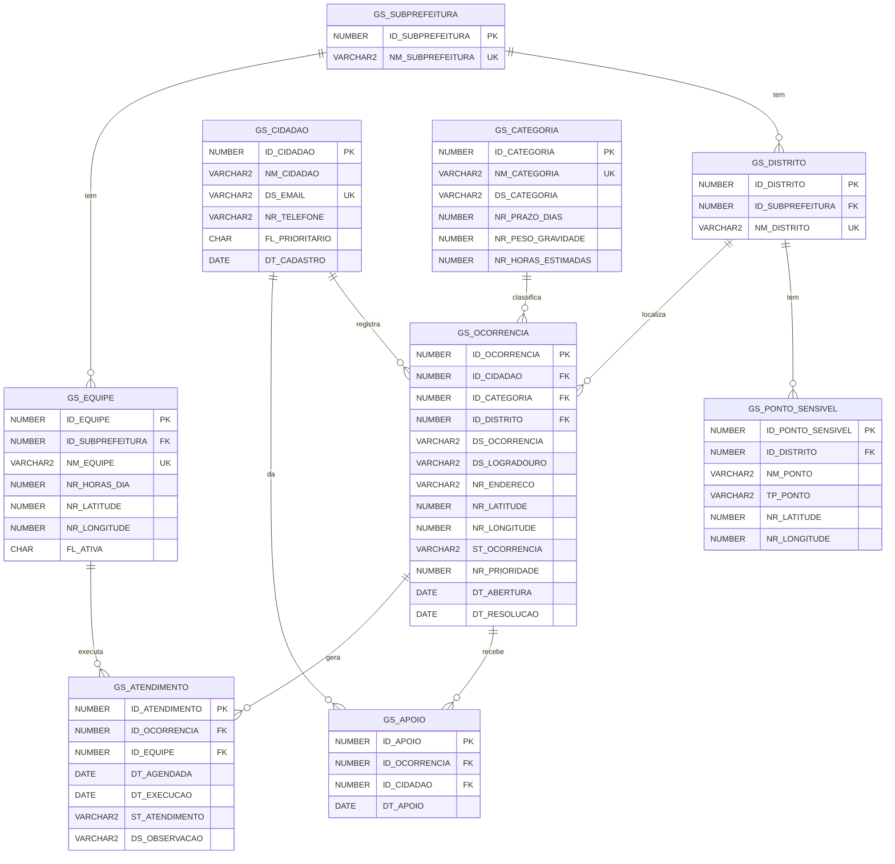

# Database Design — modelo de dados

Banco: **Oracle** (servidor da FIAP). Os scripts usam sintaxe compatível com Oracle 19c ou superior e foram testados localmente no Oracle XE 21. Este modelo também é a base da API Java (`java-api/`).

> **Atenção antes de rodar no Oracle da FIAP:** o usuário de vocês pode ter tabelas de GS anteriores com prefixo `GS_`. Antes de rodar o `00_drop.sql`, confiram:
> `SELECT table_name FROM user_tables WHERE table_name LIKE 'GS%';`
> O drop só apaga as 9 tabelas listadas abaixo. Mesmo assim, se alguma delas tiver o mesmo nome de uma tabela antiga de vocês, a antiga será apagada.

## Scripts

| Arquivo | Conteúdo |
|---|---|
| [`00_drop.sql`](00_drop.sql) | Apaga as tabelas, para recriar do zero |
| [`01_ddl.sql`](01_ddl.sql) | `CREATE TABLE` (PK, UNIQUE, CHECK) e `ALTER TABLE` (FKs) |
| [`02_dml.sql`](02_dml.sql) | `INSERT` de dados de exemplo: no mínimo 5 linhas por tabela (69 no total) |
| [`03_dql.sql`](03_dql.sql) | As 3 consultas pedidas (ver abaixo) |

Ordem de execução: `00_drop.sql` (só se as tabelas já existirem) → `01_ddl.sql` → `02_dml.sql` → `03_dql.sql`.

Os scripts de dados e consultas estão em **UTF-8**. No SQL Developer, abra com essa codificação (`Tools > Preferences > Environment > Encoding`) para preservar nomes como Rua Barão de Iguape, Zeladoria Sé - Equipe A e Estação Japão-Liberdade (Metrô). Os limites `VARCHAR2(n CHAR)` contam caracteres, e todos os textos do DML cabem nos tamanhos definidos no DDL.

## Tabelas

| Tabela | Para que serve |
|---|---|
| `GS_SUBPREFEITURA` | Subprefeituras da cidade (ex.: Sé) |
| `GS_DISTRITO` | Distritos/bairros oficiais (ex.: Liberdade) |
| `GS_CATEGORIA` | Tipos de problema, com prazo, gravidade (1–5) e horas de trabalho estimadas |
| `GS_CIDADAO` | Quem registra e apoia (dados simulados). `FL_PRIORITARIO = 'S'` para idoso/PcD |
| `GS_PONTO_SENSIVEL` | Escola, creche, UBS, hospital, ILPI (casa de repouso para idosos), terminal de ônibus ou estação de metrô. Uma ocorrência perto deles ganha prioridade |
| `GS_EQUIPE` | Equipe de campo, com horas por dia e ponto de saída (lat/long) |
| `GS_OCORRENCIA` | O problema registrado: local, status e prioridade |
| `GS_APOIO` | "Também me afeta": cada cidadão apoia uma ocorrência uma única vez |
| `GS_ATENDIMENTO` | Visita agendada ou concluída de uma equipe a uma ocorrência |

## Diagrama

O diagrama oficial foi gerado no **Oracle SQL Developer Data Modeler** (`Arquivo → Importar → Arquivo DDL → 01_ddl.sql`, Oracle Database 21c) e está em [`../docs/img/modelo-logico-data-modeler.png`](../docs/img/modelo-logico-data-modeler.png). O projeto do Data Modeler fica em [`modelo/RuaViva.dmd`](modelo/RuaViva.dmd), que abre direto na ferramenta.

Rascunho rápido do mesmo modelo, para leitura no GitHub:



## Dados de exemplo (`02_dml.sql`)

| Tabela | Linhas | Origem |
|---|---|---|
| `GS_SUBPREFEITURA`, `GS_DISTRITO` | 5 cada | Nomes oficiais de São Paulo |
| `GS_CATEGORIA` | 7 | Tipos de serviço do SP156. Prazo, peso e horas são valores de referência definidos pela equipe |
| `GS_CIDADAO` | 8 | Simulados, com email no domínio reservado `exemplo.com` |
| `GS_PONTO_SENSIVEL` | 5 | 4 fictícios em localização aproximada + Estação Japão-Liberdade |
| `GS_EQUIPE` | 5 | Simuladas |
| `GS_OCORRENCIA` | 15 | **Endereço, coordenadas, tipo e datas reais do SP156** (Liberdade, 3º tri/2026). 9 delas são na Rua Barão de Iguape |
| `GS_APOIO` | 8 | Simulados |
| `GS_ATENDIMENTO` | 11 | Simulados, coerentes com as datas de resolução reais |

No final do script, as colunas IDENTITY são ajustadas (`START WITH LIMIT VALUE`) para que os novos registros criados pela API continuem a partir do maior ID inserido.

### Regra de prioridade

```
NR_PRIORIDADE = peso da categoria × 10
              + 2 por apoio recebido
              + 15 se estiver a até 200 m de um ponto sensível
              + 10 se quem registrou for prioritário (idoso/PcD)
```

Os valores do DML já foram calculados com essa regra, que a API Java também vai aplicar.

### Quem define o peso de uma categoria

O peso (1 a 5) é informado pelo **gestor da subprefeitura** quando ele cadastra a categoria. O sistema só valida se o valor está entre 1 e 5. O cidadão não escolhe o peso.

**Sugestão de régua (opcional).** Ela não é obrigatória, mas ajuda a manter os pesos coerentes entre si. As 7 categorias de exemplo seguem esta régua:

| Peso | Critério | Exemplos |
|---|---|---|
| 5 | Impede a passagem ou põe a pessoa em risco imediato | Calçada que um cadeirante não consegue usar |
| 4 | Risco de acidente, alagamento ou doença | Buraco no asfalto, bueiro entupido |
| 3 | Obstrui a via ou deixa o local insalubre | Entulho, guia/sarjeta quebrada |
| 2 | Afeta a limpeza e o conforto | Falta de varrição |
| 1 | Mobiliário urbano, sem risco | Lixeira quebrada |

## Consultas (`03_dql.sql`)

| # | Pedido no slide | Consulta |
|---|---|---|
| 1 | INNER JOIN entre duas tabelas | Ocorrências da Rua Barão de Iguape com a categoria (`GS_OCORRENCIA` + `GS_CATEGORIA`) |
| 2 | INNER JOIN + funções de grupo + GROUP BY | Por categoria: total, resolvidas, média de dias até a resolução e prioridade média |
| 3 | LEFT OUTER JOIN + WHERE + ORDER BY | Fila do gestor: ocorrências **abertas e sem atendimento** (atendimentos cancelados não contam), da maior para a menor prioridade (`GS_OCORRENCIA` + `GS_ATENDIMENTO`) |

Resultado da consulta 3 com os dados de exemplo: o bueiro da Barão de Iguape, 288 (prioridade 71, com 3 apoios e perto da escola) aparece em primeiro.

## Como os dados se ligam ao resto do projeto

- **Prioridade (Java):** a camada BO calcula `NR_PRIORIDADE` com a regra acima.
- **Programação dinâmica:** as coordenadas das ocorrências e da base da equipe formam o grafo da rota. `NR_HORAS_ESTIMADAS` (categoria) e `NR_HORAS_DIA` (equipe) são o peso e a capacidade do problema da mochila.
- **Data Science:** o modelo logístico usa um corte fixo de **7 dias**, igual para todas as solicitações do SP156. Isso é diferente de `NR_PRAZO_DIAS`, que é o prazo de cada categoria mostrado ao cidadão (tapa-buraco e entulho, por exemplo, têm prazos diferentes).
- **Dados de exemplo:** parte das ocorrências vem de solicitações reais do SP156 na Liberdade, com endereço e coordenadas reais e sem dados pessoais.
